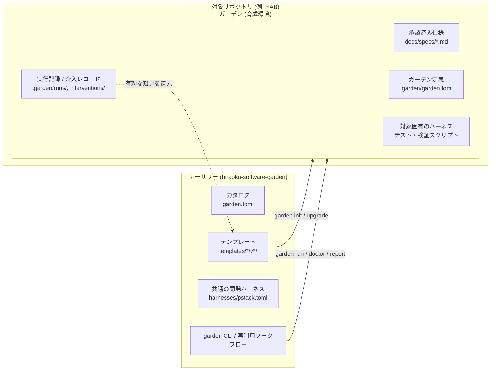

# 用語集（ユビキタス言語）

人・エージェント・設計書・コード・設定ファイルの間で同じ言葉を同じ意味で使うための**ユビキタス言語（共通語彙）**です。ここには hiraoku-software-garden 自身が使う用語だけを載せます。外部の参考事例や外部ツールの語彙は [外部参考用語集](docs/references/external-terms.md) に分けています。

---

## 全体像（どこに何があるか）

### まず覚える 7 語

| 用語 | ひとことで言うと | 実体・具体例 |
| --- | --- | --- |
| **ナーサリー（Nursery）** | 育て方の知識と共通道具を置く拠点リポジトリ | このリポジトリ `hiraoku-software-garden` そのもの |
| **対象リポジトリ** | 育てる個々のプロダクトのリポジトリ | 例: `s-hiraoku/hiraoku-agent-base`（HAB） |
| **ガーデン（Garden）** | 対象リポジトリの中に作る育成環境（1 リポジトリにつき 1 つ） | 対象リポジトリの `.garden/`・`docs/specs/`・対象固有のハーネス・CI の総体 |
| **仕様** | 「何ができ、何が起きてはいけないか」を人が定めた原本 | `docs/specs/*.md`（受け入れ条件 `AC-xxx` と不変条件 `INV-xxx`） |
| **ハーネス** | エージェントが制約を守り、実挙動を自分で確かめる仕組み | **共通の開発ハーネス**（pstack）と**対象固有のハーネス**の 2 層 |
| **結実** | 仕様の全条件を満たしたとガーデンが判断し、証拠付きで人に知らせること | `SATISFIED` 時の `summary.md`（`kind=harvest`・ラベル `garden:harvest-ready`） |
| **収穫（Harvest）** | 人が成果物と証拠を確かめ、最終的にリリースできる状態と認めること | 完成・出荷の判断は人が行い、AI には委ねない |

---

## 1. 基本構造と設定ファイル

| 用語 | 意味 | 補足・対応する実体 |
| --- | --- | --- |
| **ソフトウェアガーデン** | ナーサリーと、そこから生まれた全ガーデンを合わせた取り組み全体 | プロジェクト全体を指す名前（[思想](docs/philosophy.md)） |
| **ソフトウェアファクトリー** | 人が仕様を定め、ガーデンが実装・検証を繰り返し、人が完成を決める開発の仕組み全体 | ソフトウェアガーデンが目指す姿 |
| **テンプレート（育て方）** | ソフトウェアの種類ごとの検証観点・委譲既定値・推奨スキル・雛形一式 | `templates/{cli,web-frontend,http-api,library}/v1/`（版ごとに不変） |
| **共通の開発ハーネス** | 全対象リポジトリで共通して使う開発・検証スキル集 | 現在は `pstack` を採用（[harnesses/pstack.toml](harnesses/pstack.toml) で版を固定） |
| **対象固有のハーネス** | その製品固有の起動・操作・成否判定・再発防止チェックの実装 | 対象リポジトリに置く（ナーサリーには置かない） |
| **カタログ** | ナーサリーに登録した対象リポジトリの一覧と代表チェック | ナーサリー直下の [garden.toml](garden.toml)（`[repositories.<id>]`） |
| **ガーデン定義** | 対象リポジトリ固有のテンプレート版・仕様パス・チェック・トリガー・フロー・委譲範囲の設定 | 対象リポジトリの `.garden/garden.toml`（カタログとは別物） |
| **運用担当者** | ガーデンに任せる仕事・トリガー・フロー・委譲範囲を設定し保守する人 | 製品の利用者とは別。仕様承認や出荷判断はそれぞれの責任者が行う |

---

## 2. 仕様・実行・判定・改善（仕事の流れ順）

| 用語 | 意味 | 補足・対応する実体 |
| --- | --- | --- |
| **トリガー** | ガーデンのフローを起動するきっかけ（PR・コメント・手動実行など） | `.garden/garden.toml` の `[[triggers]]`（`garden run auto` で解決） |
| **受け入れ条件** | 実際の振る舞いで完成を判断できる条件 | 仕様書内の `AC-xxx`。AI が実装に合わせて作ったテストは含めない |
| **不変条件** | 常に守るべき性質 | 仕様書内の `INV-xxx`。必要に応じて形式検証で確かめる |
| **承認ブランチ（Trust Anchor）** | 評価基準となる仕様とガーデン定義の原本を置く信頼済みブランチ | 既定は `main`（CLI/CI の `--approval-branch` で指定）。作業ブランチでの基準改ざんを検知する |
| **フロー** | トリガーから名前で呼び出す一連の手順 | `[flows.<名前>]`（`check` / `agent` / `gate` / `report` ステップをステートマシンで実行） |
| **チェック** | 終了コードで合否が決まる自動コマンド | `[checks.<名前>]`（`kind = "check"` または `kind = "formal_check"`）。「検証」の一部 |
| **形式検証** | モデル検査・有界全状態探索・定理証明で、定めた前提のもと性質が常に成り立つかを確かめる手法 | `kind = "formal_check"`（`formal.json` を証拠として要求）。実挙動は実行時検証と併用 |
| **検証** | 仕様（受け入れ条件・不変条件）と実際の振る舞いを照らし合わせること | チェック・実行時観察・形式検証を含む。「テスト通過」だけで検証済みと言わない |
| **証拠** | 確認した条件・手順・結果・未確認の点を示す記録 | 各ステップのログ、テスト生成物、`formal.json`、`summary.md` |
| **総合判定（5 種）** | フロー実行の最終判定と CLI 終了コード | `SATISFIED` (`0`: 充足) / `UNSATISFIED` (`1`: 挙動不一致) / `INCONCLUSIVE` (`3`: **判定不能**＝環境不備や証拠欠損) / `NEEDS_HUMAN` (`4`: 人判断待ち) / `ABORTED` (`5`: 明示中断) |
| **委譲範囲・委譲モード** | ガーデンに任せる編集パス・上限・反映権限の範囲 | 3 段階: `observe_only`（観測のみ）/ `propose_pr`（PR 提案まで）/ `auto_merge`（条件付き自動マージ） |
| **事後ガード** | エージェント実行後に禁止パス改変・履歴書き換え・コスト/時間上限を検査する安全装置 | `src/garden/guard.py`（違反時は `NEEDS_HUMAN`） |
| **反映ゲート** | 検証済み変更（`verified_commit`）の PR 作成・自動マージ可否を決める決定論的ゲート | `garden reflect`（`--base` 祖先照合・ガード通過ファイル差分照合、既定ドライラン） |
| **育成** | トリガーを受けて AI が委譲範囲内で実装と検証を繰り返すこと | 人の収穫（完成・リリース判断）は含まない |
| **結実** | ガーデンが承認済み仕様の全条件を満たしたと判断し、成果物と証拠を添えて「収穫の準備ができた」と人に知らせること | `SATISFIED` 時の `summary.md`（内部識別子 `kind=harvest`・ラベル `garden:harvest-ready`） |
| **収穫（Harvest）** | 人が成果物と証拠を確かめ、最終的にソフトウェアをリリースできる状態と認めること | 完成・出荷の判断であり、AI には委ねない |
| **実行記録（Run Artifacts）** | 1 回のフロー実行の版情報・判定・ステップ結果・証拠・要約のまとまり | `.garden/runs/<run-id>/`（`run.json`, `summary.md`, `steps/`）および CI Artifacts |
| **冪等キー** | 対象・コミット・トリガー・フロー・承認済み定義/仕様の blob SHA から算出する識別子 | 同一条件の `SATISFIED` 再送による重複実行をスキップする |
| **介入レコード** | 人の手直し理由（5 分類）と再発防止策の検証状態を記録する構造化データ | `.garden/interventions/<id>.json`（`garden feedback`・`garden metrics` で記録・集計） |
| **再発防止チェック** | 失敗やレビュー指摘を型・lint・テスト・ハーネスに落とし込み、再発を自動検出できるようにしたもの | 対象リポジトリに置き、過去の失敗再現で効くことを確かめる |
| **還元** | あるガーデンで効果と適用条件を確かめた知見を、ナーサリーのテンプレートや共通手順へ取り込むこと | 未検証の知見は還元しない |

---

## 3. カタログ CLI の補足用語（`list` / `check` / `register` / `status`）

| 用語 | 意味 |
| --- | --- |
| **リポジトリ ID** | カタログ（`garden.toml`）上の安定した識別子（`<repo-id>`）。リポジトリ名と異なってもよい |
| **ワークスペース** | カタログの相対 `path` を解決する基準ディレクトリ（`--workspace`、既定はナーサリーの親ディレクトリ） |
| **取得 URL（`remote`）** | `git remote get-url <remote-name>` が返す fetch 用 URL。一致するリモートがある場合のみ `garden check` を実行する |
| **`passed` / `failed` / `unavailable`** | `garden check` の個別結果。`passed`＝終了コード 0（仕様充足とは別）、`failed`＝非ゼロ終了、`unavailable`＝実行不可（URL 不一致・未チェックアウト・起動不能等） |
| **`dirty`** | チェック開始前に未コミット変更または未追跡ファイルがある状態（`status.showUntrackedFiles=no` でも検出） |

---

## 4. 言い換え・避ける表現（早見表）

会話・ドキュメント・プロンプト・PR では、混同を防ぐため次の表記を統一します。

| 避ける言い方 | 代わりに使う言い方 | 理由 |
| --- | --- | --- |
| このリポジトリを「Garden」「Home Repo」と呼ぶ | **ナーサリー** | 対象リポジトリ側の「ガーデン」と混ざるため |
| 「庭」 | **ガーデン**（または `Garden`） | 表記ゆれを防ぐため |
| 対象リポジトリを「プロジェクト」と呼ぶ | **対象リポジトリ** | 「プロジェクト」はソフトウェアガーデン全体を指すため |
| 「共通ハーネス」「ハーネス」（単体） | **共通の開発ハーネス** / **対象固有のハーネス** | ナーサリー責務か対象リポジトリ責務かを常に明示するため |
| 「テストが通った＝検証済み」 | 確認した条件と前提を添えて**検証**と書く | チェック通過は仕様充足の一部でしかないため |
| 「結実＝収穫」「`unavailable`＝落ちた」 | **結実**（ガーデンが通知）と**収穫**（人がリリース可能と認める）、`failed` と `unavailable` を分ける | 人とガーデンの責務、挙動不一致と環境不備を区別するため |
| 外部事例の意味で単に「ソフトウェアファクトリー」 | 「〇〇の言うソフトウェアファクトリー」 | 外部事例（StrongDM 等）と本プロジェクトの定義が異なるため |

---

[プロジェクト概要](README.md) · [ソフトウェアガーデンの思想](docs/philosophy.md) · [設計書](docs/implementation/design.md) · [詳細設計書](docs/implementation/detailed-design.md) · [外部参考用語集](docs/references/external-terms.md)
