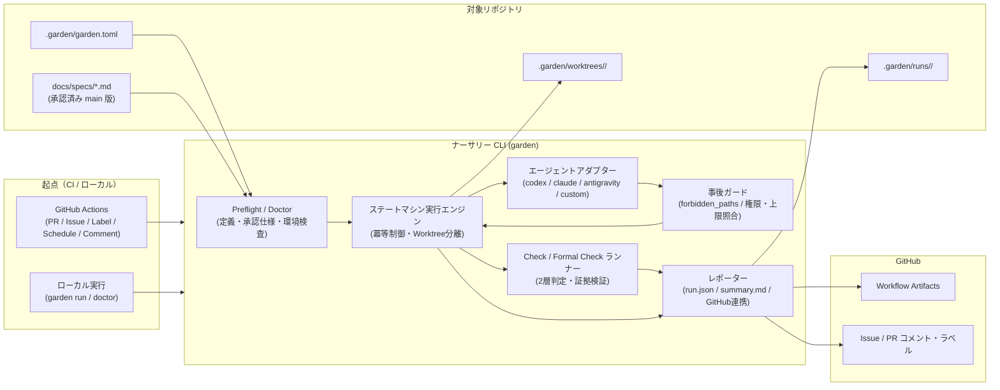
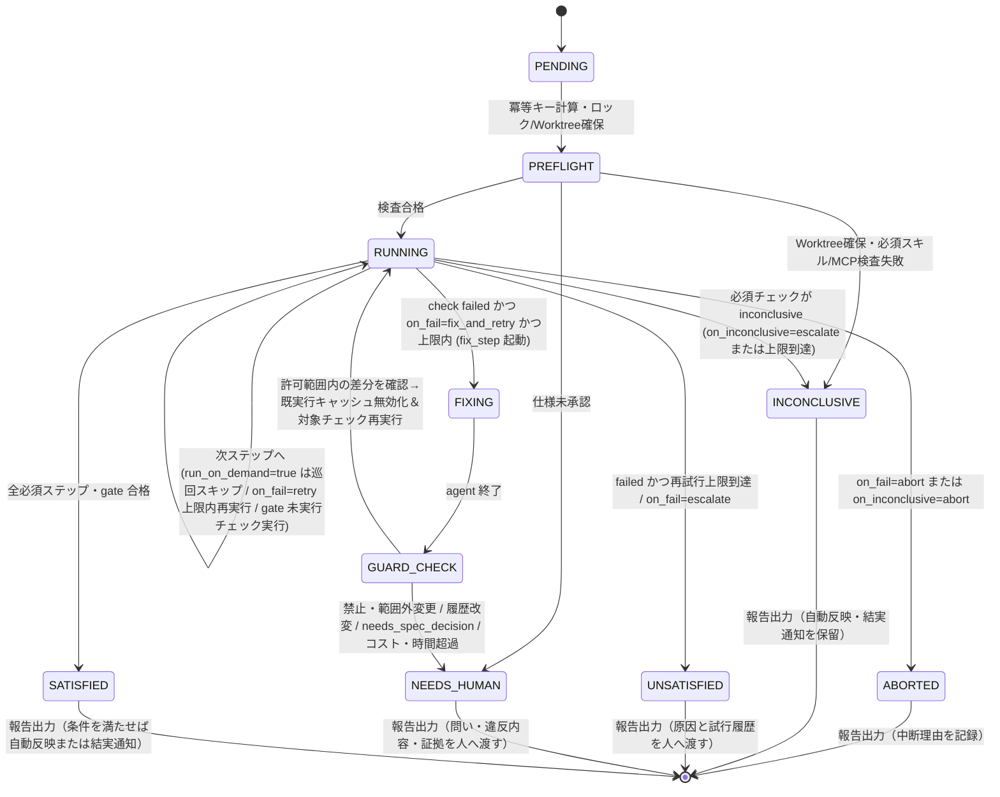

# ソフトウェアガーデン詳細設計書

この文書は、[ソフトウェアガーデン概要設計書](overview.md) の方針と 7 工程の流れを、最終形の技術仕様（アーキテクチャ、ファイル配置、スキーマ、ステートマシン、プロトコル、CLI）として定義したものです。用語は [用語集（ユビキタス言語）](../../GLOSSARY.md) に従います。

> **文書の位置づけ**
> この文書は最終形の技術仕様を定義します。現在の MVP における実装範囲・割り切り・制約は [現在の MVP 設計](../evolution/current-mvp.md)、段階的な育成計画と各段階の完了基準は [MVP 成長プラン](../evolution/roadmap.md) を参照してください。

---

## 1. 全体アーキテクチャとパッケージ構成

### 1.1 実行アーキテクチャ

イベント受付は GitHub Actions（または手元からの手動実行）、実行・判定・記録の中核はナーサリーが提供する単一 CLI（`garden`）が担います。手元でも CI でも同じ CLI コマンドと `.garden/garden.toml` を参照して再現できるようにします。



### 1.2 ナーサリーのディレクトリ構成

Python 3.11 以上を対象とし、標準ライブラリ中心（外部依存は最小限）のパッケージ構成とします。既存の `python3 garden.py list` / `check` は、ルート直下の薄いエントリポイント（シム）で後方互換を維持します。なお、`python3 garden.py` 実行時やリポジトリルートからの `unittest` 起動時はルートが `sys.path[0]` に入り、単純な `import garden` では `src/garden/` ではなく `garden.py` 自身を読み込んで衝突するため、シム側で `__path__` に `src/garden/` を公開したうえで `garden.cli:main` へ委譲します。

```text
hiraoku-software-garden/
├── pyproject.toml                  # パッケージ定義 ([project.scripts] garden = "garden.cli:main")
├── garden.py                       # 既存コマンド互換のエントリポイント (garden.cli.main へ委譲)
├── garden.toml                     # カタログ（対象リポジトリの登録一覧）
├── harnesses/
│   └── pstack.toml                 # 共通の開発ハーネス（pstack）の配布マニフェスト
├── templates/                      # 育て方のテンプレート（版ごとに不変ディレクトリ）
│   ├── cli/
│   │   └── v1/
│   │       ├── template.toml       # 検出条件・既定設定・推奨スキル・変更履歴
│   │       ├── garden.toml.tmpl    # .garden/garden.toml の生成雛形
│   │       ├── spec.md.tmpl        # 仕様書のひな型
│   │       ├── workflow.yml.tmpl   # GitHub Actions ワークフロー雛形
│   │       └── release-evidence.json # 新版公開時の新規導入＋旧版更新検証記録
│   ├── web-frontend/v1/
│   ├── http-api/v1/
│   └── library/v1/
├── src/
│   └── garden/
│       ├── __init__.py
│       ├── __main__.py             # python3 -m garden エントリポイント
│       ├── cli.py                  # argparse ベースのサブコマンド統合
│       ├── resources.py            # パッケージ同梱テンプレート・共通の開発ハーネスマニフェスト解決
│       ├── git_utils.py            # Git 操作・ref 解決・ワークツリー管理ユーティリティ
│       ├── catalog.py              # カタログ (garden.toml) の読み込み・list / check / register
│       ├── definition.py           # ガーデン定義 (.garden/garden.toml) のパースと厳格検証
│       ├── spec.py                 # 仕様書 (YAMLフロントマター・AC/INV) と承認SHA照合
│       ├── spec_diff.py            # 承認済み仕様との条件単位差分と影響解析 (spec-diff)
│       ├── doctor.py               # 環境・Git・仕様・pstack マニフェスト・必須スキル/MCP 診断
│       ├── harness.py              # 必須スキル・必須 MCP サーバー探索および要件検証
│       ├── engine.py               # 宣言的ステップのステートマシン実行と冪等・worktree管理
│       ├── checks.py               # check / formal_check 実行と2層判定
│       ├── guard.py                # forbidden_paths / allowed_paths / 権限・上限の事後検査
│       ├── adapters/
│       │   ├── base.py             # Agent Adapter 契約 (request.json / response.json)
│       │   ├── command.py          # 外部 CLI 呼び出し汎用アダプター
│       │   ├── providers.py        # codex / claude / antigravity 実プロバイダー正規化
│       │   └── mock.py             # テスト用決定論モックアダプター
│       ├── artifacts.py            # .garden/runs/<run-id>/ の書き出しとスキーマ生成
│       ├── report.py               # summary.md 生成・GitHub コメント/ラベル遷移
│       ├── publish.py              # 工程⑥の反映ゲート評価・PR 作成・条件付き自動マージ (reflect)
│       ├── feedback.py             # 介入レコードの記録・コメント解析・状態更新・集計
│       ├── metrics.py              # 実行記録と介入レコードの横断集計 (metrics)
│       ├── fleet.py                # 全登録ガーデンの健全性・直近判定の横断表示 (status)
│       ├── templates.py            # テンプレート検出・init・upgrade (構造化差分＋オプトイン)
│       └── release_gate.py         # テンプレート新版公開ゲート検証 (template-gate)
├── .garden/                        # ナーサリー自身の自己ドッグフーディング用ガーデン定義
├── docs/specs/                     # ナーサリー自身の承認済み仕様
├── test_garden.py                  # 既存カタログ CLI 後方互換テスト
├── tests/                          # 各モジュールの単体・結合・ワークフロー検証テスト
└── .github/
    └── workflows/                  # 再利用可能ワークフロー・自リポジトリCI・自己ドッグフーディング
```

### 1.3 対象リポジトリ側のファイル配置

ナーサリー直下のカタログ（`garden.toml`）と名前が衝突するのを防ぎ、対象リポジトリのルートを散らかさないため、対象リポジトリ側の設定と実行時出力は `.garden/` にまとめます。

```text
<target-repo>/
├── .garden/
│   ├── garden.toml                 # ガーデン定義（Git 管理）
│   ├── .gitignore                  # runs/ と worktrees/ を除外（Git 管理）
│   ├── runs/                       # 実行記録・証拠のローカル出力先（Git 非管理）
│   │   └── <run-id>/
│   ├── worktrees/                  # ローカル実行時の隔離ワークツリー（Git 非管理）
│   │   └── <run-id>/
│   └── interventions/              # 人の介入レコード（任意で Git 管理または Artifacts 保存）
├── docs/
│   └── specs/
│       └── <spec-id>.md            # 仕様書原本（Git 管理、main マージで承認）
└── .github/
    └── workflows/
        └── garden.yml              # トリガーを受けて garden CLI を呼ぶ薄いワークフロー
```

---

## 2. ガーデン定義スキーマ（`.garden/garden.toml`）

### 2.1 完全な記述例

```toml
schema_version = 1

[template]
name = "cli"
version = 1

[common_harness]
name = "pstack"
ref = "7a583913eb1b8d1a0ee76753d1a2cf072e7b54f9"
skills = ["create-verification-skill", "maintain-verification-skill"]
required_skills = ["create-formal-verification-skill"]  # pstack の core に加えて、このガーデンで必須にするスキル

[target_harness]
name = "msg-relay-harness"
version = 1
setup = ["python3", "-m", "pip", "install", "-e", ".[dev]"]
required_skills = ["relay-debug"]    # 対象リポジトリに置く製品固有の必須スキル
required_mcp = ["playwright"]        # 必須 MCP サーバー

[spec]
paths = ["docs/specs/message-relay.md"]
approval_branch = "main"

[delegation]
mode = "propose_pr"                  # observe_only | propose_pr | auto_merge
allowed_paths = ["src/**", "tests/**"]
forbidden_paths = [".garden/**", "docs/specs/**", ".github/workflows/**"]
max_retries = 2
max_duration_sec = 900
max_cost_usd = 5.0
require_checks = ["unit_test", "relay_e2e"]

[checks.unit_test]
kind = "check"
command = ["pytest", "-q"]
timeout_sec = 180
covers = ["AC-001"]
inconclusive_exit_codes = [75]
status = "active"                    # active | proposed

[checks.relay_e2e]
kind = "check"
command = ["python3", "scripts/verify_relay.py"]
timeout_sec = 300
covers = ["AC-001", "AC-002"]
required_evidence = ["transcript.json"]
inconclusive_exit_codes = [75]
report_path = "report.json"          # $GARDEN_EVIDENCE_DIR からの相対パス
status = "active"

[checks.protocol_model]
kind = "formal_check"
tool = "quint"                       # tlc | quint | lean4 | python-exhaustive
model_path = "formal/relay.qnt"
command = ["quint", "verify", "formal/relay.qnt", "--invariant=no_duplicate_delivery"]
timeout_sec = 300
covers = ["INV-001"]
invariants = ["INV-001"]
status = "active"

[agents.default]
adapter = "codex"                    # codex | claude | gemini | antigravity | custom | mock
command = ["codex", "exec", "--sandbox", "workspace-write"]
timeout_sec = 600
max_cost_usd = 2.0                   # 省略可。allow_unknown_cost = true とは併用不可
# allow_unknown_cost = false         # 費用を返さない CLI（例: Gemini CLI）で max_retries/max_duration_sec 制御に明示同意する場合のみ true

[[triggers]]
id = "pr-verify"
event = "pull_request"
flow = "verify_and_fix"
[triggers.conditions]
actions = ["opened", "synchronize"]

[[triggers]]
id = "scheduled-regression"
event = "schedule"
flow = "verify_only"
[triggers.conditions]
cron = "0 0 * * 1"

[flows.verify_only]
description = "変更を加えず、このフローで実行するチェックの範囲で検証と証拠収集のみを行う"
scope = "flow_checks"                # flow_checks（既定） | all_specs

[flows.verify_only.delegation]
mode = "observe_only"
allowed_paths = []
max_retries = 0

[[flows.verify_only.steps]]
id = "run_unit"
type = "check"
check = "unit_test"
on_fail = "abort"
on_inconclusive = "escalate"

[[flows.verify_only.steps]]
id = "run_e2e"
type = "check"
check = "relay_e2e"
on_fail = "escalate"
on_inconclusive = "escalate"

[[flows.verify_only.steps]]
id = "emit_report"
type = "report"
kind = "auto"

[flows.verify_and_fix]
description = "検証に失敗した場合、委譲範囲内で修正と再検証を最大2回まで試み、全仕様の結実条件を最終ゲートで確かめる"
scope = "all_specs"

[[flows.verify_and_fix.steps]]
id = "run_e2e"
type = "check"
check = "relay_e2e"
on_fail = "fix_and_retry"
fix_step = "fix_failure"
on_inconclusive = "escalate"
max_retries = 2

[[flows.verify_and_fix.steps]]
id = "fix_failure"
type = "agent"
agent = "default"
purpose = "fix"
skill = "poteto-mode"
run_on_demand = true

[[flows.verify_and_fix.steps]]
id = "final_gate"
type = "gate"
require_checks = ["unit_test", "relay_e2e", "protocol_model"]

[[flows.verify_and_fix.steps]]
id = "emit_report"
type = "report"
kind = "auto"
```

### 2.2 スキーマ検証ルール（バリデーター）

最終形の `definition.py` はロード時に以下を決定論的に検証し、違反があれば設定エラー（CLI 終了コード `2`）で拒否します。

| 対象 | 必須/任意 | 制約 |
| --- | --- | --- |
| `schema_version` | 必須 | 整数 `1` のみ受理。未知の版はエラー。 |
| `[template]` | 必須 | `name`（非空文字列）、`version`（1以上の整数）。 |
| `[common_harness]` | 必須 | `name`（既定 `"pstack"`）、`ref`（40文字小文字16進数 SHA）、`skills`（このガーデンが使う pstack スキルの一覧）、`required_skills`（任意。ナーサリーの `harnesses/pstack.toml` の `[skills].core` に加えて、このガーデンで必須にする pstack スキル）。宣言場所の分担は §7.2 を参照。 |
| `[target_harness]` | 必須 | `name`（非空文字列）、`version`（1以上の整数）、`setup`（任意の非空文字列配列）、`required_skills`（任意。対象リポジトリに置く製品固有の必須スキル）、`required_mcp`（任意。必須 MCP サーバー一覧）。宣言場所の分担は §7.2 を参照。 |
| `[spec]` | 必須 | `paths`（1件以上のリポジトリ相対パス、親参照 `..` 禁止）、`approval_branch`（既定 `"main"`）。 |
| `[delegation]` | 必須 | `mode` は `observe_only` / `propose_pr` / `auto_merge`。`allowed_paths` は `propose_pr` と `auto_merge` で1件以上を必須とし、`observe_only` では省略または空配列を許容する。`max_retries`（0以上の整数、**フロー全体での累計再試行上限**）、`max_duration_sec`（正整数）、`max_cost_usd`（0以上の数値、**フロー1回あたりの累計コスト上限**）。`forbidden_paths` には実装上つねに `.garden/**` と `[spec].paths` 全件を強制追加する（記述漏れがあっても CLI が自動付与し除外不可）。 |
| `[checks.<name>]` | 1件以上 | `command` は非空文字列配列。`kind` は `"check"` または `"formal_check"`。`status` は `"active"` または `"proposed"`（既定 `"active"`）。`formal_check` では `tool`・`model_path`・`invariants` を必須とする。 |
| `[agents.<name>]` | 任意（`agent` ステップ利用時は必須） | `adapter` は `"codex"` / `"claude"` / `"antigravity"` / `"custom"` / `"mock"`。`command` は非空文字列配列。`timeout_sec`（正整数）。`max_cost_usd`（任意、**1回のエージェント呼び出しあたりの上限**。実効上限は `min(agent.max_cost_usd, remaining_flow_budget)`）。 |
| `[flows.<name>]` | 1件以上 | `scope` は `"flow_checks"`（既定）または `"all_specs"`。`steps` は1件以上。各 `step.id` はフロー内で一意。参照する `check` / `agent` / `fix_step` / `gate.require_checks` がすべて実在すること。ステップ属性の制約は直下の表を参照。 |
| `[[triggers]]` | 任意 | `id` は一意。`flow` が `[flows]` に存在すること。 |

**フロー内ステップ属性の制約**:

| 属性 | 許容値と検証ルール |
| --- | --- |
| `run_on_demand` | 真偽値（既定 `false`）。`true` のステップは通常巡回では実行されず、`fix_step` 等からオンデマンド起動される。どのステップからも参照されない `run_on_demand = true` はエラー。 |
| `on_fail` | `"abort"`（即座に `ABORTED` で中断）、`"escalate"`（`UNSATISFIED` へ遷移）、`"retry"`（上限内で再実行）、`"fix_and_retry"`（`fix_step` を必須とし、かつ `effective_delegation.mode != "observe_only"` であること）。 |
| `on_inconclusive` | `"escalate"`（既定、`INCONCLUSIVE` で保留）、`"retry"`、`"abort"`。 |
| `max_retries` | 任意の 0 以上の整数。`step.max_retries <= effective_delegation.max_retries` を強制し、省略時は `effective_delegation.max_retries` を適用する。フロー全体の累計再試行回数も `effective_delegation.max_retries` を超えない。 |

### 2.3 委譲範囲の「厳格化のみ許可」ルール

`[flows.<name>.delegation]` でデフォルト `[delegation]` を上書きするとき、バリデーターは次の順序関係に違反する緩和をすべてエラーで弾きます。

- `mode`: `observe_only (0) < propose_pr (1) < auto_merge (2)` とし、`flow.mode <= default.mode` であること。
- `allowed_paths`
  - フローのモードが `propose_pr` または `auto_merge` の場合、省略時はデフォルトのリストを継承する。明示する場合はデフォルトのリストの非空の部分集合とし、空配列は設定エラー（終了コード `2`）とする。
  - フローのモードが `observe_only` の場合、省略または空配列の指定で許可パスを空にする。非空の指定は設定エラー（終了コード `2`）とする。
- `forbidden_paths`: デフォルトとの和集合をとる（削除不可、追加のみ）。
- `max_retries`, `max_duration_sec`, `max_cost_usd`: すべて `flow.value <= default.value` であること。
- `require_checks`: デフォルトの必須チェックを削除できない（追加のみ）。

---

## 3. 仕様ファイル形式・承認メカニズム・評価の独立性

### 3.1 仕様書フォーマット（`docs/specs/<spec-id>.md`）

仕様書は人が読みやすく、かつ CLI が機械的に ID を抽出できる Markdown＋YAML フロントマター形式とします。

```markdown
---
spec_id: message-relay
version: 1
status: approved
title: エージェント間メッセージ送受信の到達保証
owner: "@s-hiraoku"
tracking_issue: 40
---

## 目的
エージェント A から送信した検証用メッセージが、エージェント B を起動して返信まで完了することを保証する。

## 受け入れ条件
- **AC-001**: 正常なメッセージを送信すると、30秒以内に応答メッセージを受信できる。
- **AC-002**: 受信先が応答しない場合、送信・受信・起動・返信のどの段階まで確認できたかが記録される。

## 不変条件
- **INV-001**: 同一メッセージ ID の完了通知が重複して届いても、確定処理は最大1回しか実行されない。
```

**抽出規約（`spec.py`）**:
- フロントマターは先頭の `---` 〜 `---` ブロック。必須キーは `spec_id`（文字列）、`version`（正整数）、`status`（`draft` | `approved` | `superseded`）、`title`（文字列）。任意キー `tracking_issue`（正整数）は、その機能の追跡 Issue の番号で、仕事の分割（§4.5）と結実通知（§6.5）の投稿先に使う。
- 受け入れ条件 ID は正規表現 `^-\s+\*\*(AC-\d{3,})\*\*:\s+(.+)$`、不変条件 ID は `^-\s+\*\*(INV-\d{3,})\*\*:\s+(.+)$` で抽出し、同一ファイル内の重複 ID をエラーにする。
- `.garden/garden.toml` の `[checks.<name>].covers` に書かれた ID が、参照先仕様書に存在しない場合はバリデーションエラーにする。

### 3.2 承認済み仕様・ガーデン定義の信頼の起点（Trust Anchor）

AI や未承認 PR が仕様ファイルやガーデン定義（`.garden/garden.toml`）を書き換えて `status: approved` にしたり、必須ゲートや委譲制約を緩めたりする抜け道を塞ぐため、**仕様とガーデン定義の両方について、保護された承認ブランチ（既定 `main`）にマージ済みの Git オブジェクト**を信頼の起点（原本）とします。

**Preflight 照合手順**:
1. 信頼できる承認ブランチ名（既定 `main`、または CLI・ワークフロー引数の `--approval-branch` で明示指定。**PR ブランチ側の `.garden/garden.toml` からは読まない**）を `refs/heads/<branch>` または `refs/remotes/origin/<branch>` として厳格解決し（`HEAD` 等の生 ref は拒否）、コミット SHA（`approval_commit`）を取得する。
2. **ガーデン定義の照合**:
   - `git show <approval_commit>:.garden/garden.toml` と `git rev-parse <approval_commit>:.garden/garden.toml`（`approved_definition_blob_sha`）を取得し、評価・検証に用いるルール（`[delegation]`、`[flows]`、`[checks]`、`[agents]`、`[spec]`）の基準とする。
   - 作業対象ブランチ（`HEAD`）上の `.garden/garden.toml` の blob SHA（`head_definition_blob_sha`）と比較する。
   - **承認ブランチに `.garden/garden.toml` が未存在（初回導入 PR）**、または **`head_definition_blob_sha != approved_definition_blob_sha`（テーブルを問わず1バイトでも差分がある）** 場合、`evaluation_criteria_changed = true` として記録する。
3. **仕様の照合**:
   - 承認済みガーデン定義（初回導入時のみ `HEAD` 側）の `[spec].paths` それぞれについて `git show <approval_commit>:<spec_path>` と `git rev-parse <approval_commit>:<spec_path>`（`approved_blob_sha`）を取得する。
   - 取得した仕様のフロントマターが `status == "approved"` であることを確認する。
   - 作業対象ブランチ（`HEAD`）上の `spec_path` の blob SHA が `approved_blob_sha` と一致するか確認する。
     - **一致する場合**: 承認済み仕様として続行し、`run.json` に `approval_commit`・`approved_blob_sha`・`spec_version` を記録する。
     - **承認ブランチに存在しない／`status != "approved"` の場合**: 実装・自動反映フローを実行せず `NEEDS_HUMAN`（理由: `spec_not_approved`）で終了する。
     - **作業ブランチで仕様が変更されている場合**: 仕様改定 PR とみなし、`evaluation_criteria_changed = true` かつ `mode` を強制的に `observe_only` へ降格して差分を報告し、人による承認（`main` へのマージ）を待つ。

### 3.3 「自作自演のオールグリーン」を防ぐ評価の独立性

1. **禁止パスの機械的強制**: `agent` ステップの実行後、`guard.py` が `<target_commit>` を基準に `git diff --name-only --no-renames <target_commit>` および未追跡ファイルを走査し（詳細は §5.4）、`forbidden_paths`（`.garden/**`、`docs/specs/**` 等）や `allowed_paths` 外の変更が1つでもあれば、エージェントの成否にかかわらず違反として変更を破棄（または隔離ブランチを破棄）し `NEEDS_HUMAN`（`delegation_violation`）へ遷移します。
2. **承認済みガーデン定義による評価と変更時ロック**:
   - 通常の PR 検証では、PR ブランチ側ではなく **`approval_branch` 側の `.garden/garden.toml`** を評価基準として採用します（PR 側で `[flows.*.steps]` から `gate` を外したり、`[flows.*.delegation]` や `[agents]` を書き換えても評価をすり抜けられません）。
   - `.garden/garden.toml` または仕様ファイルに何らかの差分がある PR（`evaluation_criteria_changed == true`）では、差分一覧を実行記録に残したうえで、たとえ全チェックが `passed` でも `auto_merge` と結実通知を機械的に禁止します。実効的な委譲モードは変更の種類ごとに次のとおり降格し、反映には人のレビューと承認ブランチへのマージを必須とします。

     | PR の変更内容 | 実効的な委譲モード |
     | --- | --- |
     | 仕様ファイルの変更を含む（ガーデン定義の変更の有無を問わない） | `observe_only` に降格し、許可パスを空にする（§3.2 の仕様改定 PR。エージェントによる修正も行わない） |
     | ガーデン定義（`.garden/garden.toml`）だけの変更 | 承認済み定義の `auto_merge` を `propose_pr` に降格する（`observe_only` と `propose_pr` はそのまま） |

     どちらの場合も `SATISFIED` の報告は結実（`kind = "harvest"`）ではなく `verified` とし、基準の変更を人がレビューするまで収穫の判断には進めません。

---

## 4. 実行エンジン・ステートマシン・2層判定ルール

### 4.1 ステートマシンと状態遷移



**ステップ実行ルール（`gate`・`run_on_demand`・再試行・定義エラー）**:
- ガーデン定義（`.garden/garden.toml`）のスキーマ不備や未定義フロー指定は、ステートマシン開始前に CLI 終了コード `2` で即座に失敗し、実行記録（Run Artifacts）を生成しない。
- `run_on_demand = true` のステップは通常の順次実行ではスキップされ、他ステップの `fix_step` 等から呼び出されたときだけ実行します。
- `type = "gate"` は、`require_checks` に列挙されたチェックのうち、**現在のワークツリー状態（直近の `FIXING` ステップ以降）で未実行のチェックを順に実行**し、すでに最新状態で実行済みのチェックは直前の結果を参照します。`FIXING` によりファイルが変更された場合は既実行チェック結果のキャッシュを無効化し、その後の `gate` で必須チェックを必ず再実行します。
- 再試行上限は、ステップ単位の `max_retries`（省略時は `effective_delegation.max_retries`）と、フロー全体の累計上限 `effective_delegation.max_retries` の両方を同時に強制します。

### 4.2 冪等キーと作業環境分離

- **冪等キー**:
  ```text
  idempotency_key = sha256(
      f"{canonical_remote}\n{target_commit}\n{trigger_event}\n{trigger_id}\n{flow_name}\n{approved_definition_blob_sha}\n{sorted_spec_blob_shas}"
  )[:16]
  ```
- **Run ID**: `<YYYYMMDDTHHMMSSZ>-<idempotency_key[:8]>`（例: `20261123T084500Z-a1b2c3d4`）。
- **重複実行の防止（CI・ローカルで統一）**:
  - **スキップ条件（共通）**: 同一 `idempotency_key` かつ終端判定が **`SATISFIED`** の実行記録がすでに存在する場合のみ重複としてスキップします（`--force` 指定時のみ再実行可）。`INCONCLUSIVE` / `UNSATISFIED` / `NEEDS_HUMAN` / `ABORTED` の記録は、環境復旧や修正後の再試行を妨げないためスキップしません。
  - **GitHub Actions** は対象リポジトリと Issue/PR 単位で同時実行を制御し、同一 PR の `auto` と `/garden resume` のラベル更新が重ならないようにする。

    ```yaml
    concurrency:
      group: "garden-${{ github.repository }}-${{ inputs.issue_number || github.event.pull_request.number || github.ref }}"
      cancel-in-progress: false
      queue: max
    ```

    `queue: max` で、待機中の PR 検証が後から来た `/garden resume` によって取り消されるのを防ぐ（既定の `queue: single` では待機できるのは 1 件だけで、新しい実行が来ると待機中の実行は取り消される）。待機枠は同時実行グループごとに最大 100 件で、上限に達すると新たにキューに入る実行はキャンセルされる。`queue: max` は `cancel-in-progress: true` と併用できない（ワークフローの検証エラーになる）ため、`cancel-in-progress: false` を明示する。待機の順番は待ち始めた順を基本とするが、保証はされない。[GitHub Actions の同時実行制御](https://docs.github.com/en/actions/how-tos/write-workflows/choose-when-workflows-run/control-workflow-concurrency) · [2026-05-07 の変更履歴](https://github.blog/changelog/2026-05-07-github-actions-concurrency-groups-now-allow-larger-queues)

    実行前には Issue/PR の HTML マーカー（`idempotency_key=... verdict=SATISFIED`）を照合して重複をスキップする。
  - **ローカル実行**: `.garden/runs/` 内の既存 `run.json` から同一 `idempotency_key` かつ `verdict == "SATISFIED"` の記録を照合します。作業ツリー汚染を防ぐため、`git worktree add --detach .garden/worktrees/<run-id> <target_commit>`（修正フローでは `git worktree add -b garden/<run-id> .garden/worktrees/<run-id> <target_commit>`）で隔離実行し、終了時に削除します（`--keep-worktree` で調査用に残せます）。

### 4.3 2層の決定論的判定ルール（`checks.py`）

チェックの実行時には、子プロセスへ以下の環境変数を渡します。
- `GARDEN_RUN_ID`: 実行 ID
- `GARDEN_STEP_ID`: ステップ ID
- `GARDEN_EVIDENCE_DIR`: 当該ステップ専用の証拠出力ディレクトリ（`.garden/runs/<run-id>/steps/<nn>-<step_id>/evidence/`）
- `GARDEN_REPORT_PATH`: 構造化レポート出力先（`report_path` 設定時）

#### 第1層: チェック単位の判定（`check_status`）

| 優先順位 | 条件 | 判定 | 理由コード例 |
| --- | --- | --- | --- |
| 1 | コマンド起動不能（`OSError`）、タイムアウト、チェックアウト/Git 異常 | `inconclusive`（カタログ CLI の `unavailable` に相当） | `command_unavailable`, `timeout` |
| 2 | 終了コードが `inconclusive_exit_codes`（既定 `[75]`）に含まれる | `inconclusive` | `exit_code_inconclusive` |
| 3 | `report_path` が指定され、JSON 内に `"status": "inconclusive"` が明示されている | `inconclusive` | `reported_inconclusive` |
| 4 | 終了コードが `0` かつ `required_evidence` のいずれかのファイルが存在しない（または 0 バイト） | `inconclusive` | `missing_evidence` |
| 5 | `kind == "formal_check"` で、必須メタデータ（`formal.json` または規定出力）が取得できない／探索未完了 | `inconclusive` | `formal_incomplete` |
| 6 | 終了コードが `0` かつ上記に該当しない | `passed` | `ok` |
| 7 | 終了コードが非 `0` かつ上記に該当しない | `failed` | `assertion_failed` |

※ `status = "proposed"` のチェックはデフォルトでは実行せず（`--include-proposed` で試行実行可能）、結果にかかわらず第2層の必須判定には影響させません。

#### 第2層: 受け入れ条件・フロー総合判定（`verdict`）

- **受け入れ条件の評価対象スコープ（`flow.scope`）**:
  - `scope = "flow_checks"`（既定）: そのフローのステップ・`gate` で参照する `active` チェックの `covers` に含まれる条件 ID のみを評価対象とする（部分検証・定期回帰フロー向け）。評価対象外の条件は `not_evaluated` として記録し、`INCONCLUSIVE` の原因にしない。
  - `scope = "all_specs"`: `[spec].paths` の承認済み仕様に定義された**すべての** `AC-*` / `INV-*` を評価対象とする。自動反映は、`scope = "all_specs"` のフローが `SATISFIED` かつ `evaluation_criteria_changed == false` の場合にのみ許可する。結実通知（`kind = "harvest"`）の条件は §6.5 で定める。
- **受け入れ条件（`AC-*` / `INV-*`）単位の判定**（評価対象 ID ごと）:
  - 先行ステップの失敗、中断、人判断待ちによってフローが途中終了し、当該条件のチェックが実行されなかった場合は `not_evaluated` とする（先行する `UNSATISFIED` / `ABORTED` / `NEEDS_HUMAN` を `INCONCLUSIVE` で上書きしない）。
  - フローが完走したにもかかわらず、その ID を `covers` に含み実行された `active` チェックが 0 件の場合は `inconclusive`（未検証）とする。
  - 紐づく実行済みチェックに 1 件でも `inconclusive` がある場合は `inconclusive` とする。
  - `inconclusive` がなく、1 件でも `failed` がある場合は `unsatisfied` とする。
  - 紐づくすべての実行済みチェックが `passed` の場合は `satisfied` とする。
- **フロー総合判定の優先順位**（複数事由が同時に成り立つ場合は上位を採用）:
  1. **`NEEDS_HUMAN`**: 仕様未承認、権限・禁止パス違反、履歴改変、`needs_spec_decision`、コスト・時間上限超過のいずれかが発生
  2. **`INCONCLUSIVE`**: 上記がなく、1件でも必須ステップまたは評価対象の受け入れ条件が `inconclusive`（自動反映および結実通知を機械的に禁止）
  3. **`UNSATISFIED`**: 上記がなく、1件でも `unsatisfied` / `failed` がある
  4. **`ABORTED`**: 上記がなく、`on_fail = "abort"` または `on_inconclusive = "abort"` により明示的に中断した
  5. **`SATISFIED`**: すべての必須ステップ・`gate`・評価対象の受け入れ条件が合格

### 4.4 形式検証（`formal_check`）の構造化証拠規約

`kind = "formal_check"` のステップは、`$GARDEN_EVIDENCE_DIR/formal.json`（または組み込みラッパーの生成物）として以下のスキーマを出力します。

```json
{
  "schema_version": 1,
  "tool": "quint",
  "tool_version": "0.22.0",
  "model_path": "formal/relay.qnt",
  "model_blob_sha": "9f86d081884c7d659a2feaa0c55ad015a3bf4f1b",
  "invariants": ["INV-001"],
  "assumptions": ["max_messages=3", "network_may_duplicate=true"],
  "scope": "bounded model check (max_steps=10)",
  "completed": true,
  "result": "proved",
  "counterexample": null
}
```

`completed == false` の場合、終了コードに関わらず判定は `inconclusive` となります。`result` は `"proved"` | `"counterexample_found"` | `"inconclusive"` のいずれかです。

### 4.5 仕事の分割と着手順

工程③で、人が一つの機能の仕様（受け入れ条件と委譲範囲）を承認したら、ガーデンはその範囲で仕事を分け、着手順を決めます。分割と順序の判断はエージェントに任せ、CLI はその結果が承認済み仕様を漏れなく覆っているかを決定論的に検証します。

**仕事の表現**:
- 一つの機能は、仕様のフロントマター `tracking_issue` が指す**追跡 Issue** に対応する。
- 一つの仕事は、ラベル `garden:work` を付けた Issue で表す。本文先頭に次の HTML マーカーを置き、担当する受け入れ条件と依存関係を機械可読にする。

  ```markdown
  <!-- garden:work v1 spec_id=drafts spec_version=2 criteria=AC-001,AC-003 depends_on=41 tracking_issue=40 -->
  ```

**分割の手順**:
1. 追跡 Issue にラベル `garden:ready` が付き、かつ参照する仕様が承認ブランチで `status: approved` のときに、`event = "issues"`・`actions = ["labeled"]`・`label = "garden:ready"` のトリガーから分割フローを起動する。
2. 分割フローの `agent` ステップ（`purpose = "plan"`）は、`response.json` と同じステップディレクトリ（`.garden/runs/<run-id>/steps/<nn>-<step_id>/plan.json`）に仕事の一覧を書き出す。

   ```json
   {
     "schema_version": 1,
     "spec_id": "drafts",
     "spec_version": 2,
     "spec_blob_sha": "...",
     "work_items": [
       { "key": "save", "title": "下書きをサーバーに保存する", "criteria": ["AC-001"], "depends_on": [] },
       { "key": "restore", "title": "別の端末で下書きを復元する", "criteria": ["AC-002", "AC-003", "INV-001"], "depends_on": ["save"] }
     ],
     "order": ["save", "restore"],
     "order_rationale": "復元は保存形式に依存するため、保存を先に確定する",
     "human_priority_applied": false
   }
   ```
3. CLI は `plan.json` を次の規則で検証し、違反があれば `NEEDS_HUMAN`（`invalid_plan`）とする。
   - 全 `work_items` の `criteria` の和集合が、その仕様の `AC-*` / `INV-*` すべてと一致する（漏れも、仕様にない ID も認めない）。
   - 各仕事は 1 件以上の条件を持ち、`key` は一意で、`depends_on` は実在する `key` だけを参照し、循環しない。
   - `order` は全 `key` をちょうど一度ずつ含み、依存関係に矛盾しない。
4. 検証に通った計画は、委譲モードが `propose_pr` 以上のとき `garden:work` Issue として作成・更新し、追跡 Issue に一覧と `order_rationale` を記録する。`observe_only` では計画を実行記録と追跡 Issue へのコメントに残すだけとする。

**着手順**:
- 人が追跡 Issue で着手順を明示した場合（ラベル `garden:priority` を付けた仕事を先に扱う、または追跡 Issue に順序を書く）は、依存関係に反しない限りその指定に従い、`human_priority_applied = true` を記録する。
- 指定がない仕事の順序はエージェントが決め、その理由を `order_rationale` に残す。
- 依存先が終わった仕事から着手する。仕様判断を待つ仕事（`garden:needs-human`）に依存する仕事は保留し、独立した仕事は続ける。

**分け直し・一時停止・仕様改定**:
- 育成の途中で仕事を分割・統合・並べ替えるときも、同じ `plan.json` の検証を通し、追跡 Issue に前後の計画を残す。分け直した後も、各仕事から受け入れ条件をたどれる。
- 人が追跡 Issue にラベル `garden:paused` を付けている間は、その仕様に属する仕事のトリガーを起動せず、スキップした事実だけを記録する。
- 人が仕様の新版を承認したら、`garden spec-diff` で変わった条件を抽出し、その条件を持つ仕事だけを計画し直す。変わらない条件の仕事と実装は引き継ぐ。

---

## 5. エージェントアダプター契約（Agent Adapter Protocol）

コーディングエージェントへのロックインを避けるため、`garden` CLI と各エージェント CLI の間をファイルベースの JSON プロトコルで疎結合にします。

### 5.1 呼び出し規約

CLI は `.garden/runs/<run-id>/steps/<nn>-<step_id>/` 配下に `request.json` と `prompt.md` を生成し、次の環境変数を設定して `[agents.<name>].command` を起動します。
- `GARDEN_AGENT_REQUEST`: `request.json` の絶対パス
- `GARDEN_AGENT_RESPONSE`: アダプターが書き出す `response.json` の絶対パス
- `GARDEN_AGENT_PROMPT`: エージェントへ渡す指示プロンプト（`prompt.md`）の絶対パス
- `GARDEN_WORKTREE`: 作業対象の隔離ワークツリーパス

### 5.2 `request.json` スキーマ

```json
{
  "schema_version": 1,
  "run_id": "20261123T084500Z-a1b2c3d4",
  "step_id": "fix_failure",
  "purpose": "fix",
  "skill": "poteto-mode",
  "worktree_path": "/abs/path/to/.garden/worktrees/20261123T084500Z-a1b2c3d4",
  "specs": [
    {
      "spec_id": "message-relay",
      "path": "docs/specs/message-relay.md",
      "version": 1,
      "blob_sha": "..."
    }
  ],
  "delegation": {
    "mode": "propose_pr",
    "allowed_paths": ["src/**", "tests/**"],
    "forbidden_paths": [".garden/**", "docs/specs/**", ".github/workflows/**"],
    "max_cost_usd": 2.0
  },
  "context": {
    "failed_step_id": "run_e2e",
    "failed_check": "relay_e2e",
    "stderr_path": ".../stderr.log",
    "evidence_dir": ".../evidence"
  }
}
```

### 5.3 `response.json` スキーマ

```json
{
  "schema_version": 1,
  "outcome": "completed",
  "summary": "タイムアウト時のリトライ上限処理を修正しました。",
  "changed_files": ["src/relay.py", "tests/test_relay.py"],
  "question": null,
  "usage": {
    "model": "example-model",
    "input_tokens": 12000,
    "output_tokens": 3500,
    "cost_usd": 0.42
  }
}
```

- `outcome` は `"completed"` | `"needs_spec_decision"` | `"blocked"` | `"failed"`。
- `purpose = "plan"` のステップでは、アダプターは `response.json` と同じディレクトリに §4.5 の `plan.json` を書き出す。
- `outcome == "needs_spec_decision"` の場合、`question` オブジェクトに `prompt` を必須とし、`options`・`impact`・`blocked_work` を推奨項目として含める。CLI は即座に `NEEDS_HUMAN`（`spec_question`）へ遷移する。
- アダプターが `response.json` を書き出せなかった場合、または JSON スキーマ不正の場合は `failed` 扱いとし、事後ガードで変更差分を検査する。

### 5.4 事後ガード（`guard.py`）

CLI は `response.json` の `changed_files` を信頼せず、必ずワークツリー上で実行開始時点のコミット `<target_commit>` を基準に実差分を検証します。具体的には以下をすべて検査します。
- `git merge-base --is-ancestor <target_commit> HEAD`: 偽の場合（エージェントが `<target_commit>` 以前の履歴を改変・巻き戻した場合）は違反（`history_rewritten`）とする。
- `git diff --name-only --no-renames <target_commit>`: エージェントが途中でコミットした場合も含め、`<target_commit>` からの全変更・追加・削除パスを取得する。`--no-renames` を必須とすることで、禁止パス（例: `docs/specs/x.md`）を許可パス（例: `src/`）へリネーム移動した場合も元の禁止パス削除として確実に検出する。
- `git status --porcelain --untracked-files=all`: 未追跡ファイルを取得する。

上記の全変更・未追跡ファイル集合に対して次を判定します。
- `mode == "observe_only"` なのに変更・未追跡ファイルが 1 件以上ある場合は違反とする。
- いずれかのパスが `forbidden_paths` に一致する場合は違反とする。
- `propose_pr` と `auto_merge` では、`allowed_paths` のどのパターンにも一致しないパスがある場合は違反とする。
- 1 回のエージェント呼び出しの `cost_usd > min(agent.max_cost_usd, remaining_flow_budget)`、またはフロー累計 `cost_usd > delegation.max_cost_usd`、またはフロー経過時間 `> delegation.max_duration_sec` の場合は上限超過とする。

違反・超過時は、許可外の差分を自動反映や PR 作成に進めず、`NEEDS_HUMAN` として証拠を残します。

---

## 6. 実行記録・証拠・人への引き渡し・介入記録

### 6.1 Run Artifacts のディレクトリ規約

ローカル実行・GitHub Actions Artifacts ともに同一レイアウトを出力します。

```text
.garden/runs/<run-id>/
├── run.json                        # 実行メタデータ・版・総合判定・測定値
├── summary.md                      # Issue / PR 投稿用の構造化 Markdown 要約
└── steps/
    ├── 01-run_e2e/
    │   ├── step.json               # ステップ結果・終了コード・理由コード・所要時間
    │   ├── stdout.log
    │   ├── stderr.log
    │   └── evidence/               # ステップ固有の証拠ファイル・formal.json・report.json
    └── 02-fix_failure/
        ├── step.json
        ├── request.json
        ├── prompt.md
        ├── response.json
        ├── stdout.log
        └── stderr.log
```

### 6.2 `run.json` スキーマ

```json
{
  "schema_version": 1,
  "run_id": "20261123T084500Z-a1b2c3d4",
  "idempotency_key": "a1b2c3d4e5f60718",
  "trigger": {
    "event": "pull_request",
    "id": "pr-verify",
    "ref": "0123456789abcdef0123456789abcdef01234567",
    "issue_or_pr": 42
  },
  "target": {
    "remote": "https://github.com/example/target.git",
    "commit": "0123456789abcdef0123456789abcdef01234567",
    "dirty": false,
    "evaluation_criteria_changed": false,
    "evaluation_change_reasons": []
  },
  "versions": {
    "cli": "0.1.0",
    "template": { "name": "cli", "version": 1 },
    "common_harness": { "name": "pstack", "ref": "7a583913eb1b8d1a0ee76753d1a2cf072e7b54f9" },
    "target_harness": { "name": "msg-relay-harness", "version": 1 },
    "approved_definition_blob_sha": "...",
    "head_definition_blob_sha": "...",
    "specs": [
      {
        "spec_id": "message-relay",
        "path": "docs/specs/message-relay.md",
        "version": 1,
        "approval_branch": "main",
        "approval_commit": "...",
        "blob_sha": "...",
        "modified_in_head": false
      }
    ]
  },
  "flow": "verify_and_fix",
  "flow_scope": "all_specs",
  "effective_delegation": {
    "mode": "propose_pr",
    "max_retries": 2,
    "max_duration_sec": 900,
    "max_cost_usd": 5.0
  },
  "started_at": "2026-11-23T08:45:00Z",
  "finished_at": "2026-11-23T08:47:12Z",
  "duration_sec": 132.4,
  "retries_used": 1,
  "usage": { "input_tokens": 12000, "output_tokens": 3500, "cost_usd": 0.42 },
  "verdict": "SATISFIED",
  "criteria_results": {
    "AC-001": { "verdict": "satisfied", "checks": ["unit_test", "relay_e2e"] },
    "AC-002": { "verdict": "satisfied", "checks": ["relay_e2e"] },
    "INV-001": { "verdict": "satisfied", "checks": ["protocol_model"] }
  },
  "spec_results": {
    "message-relay": { "spec_version": 1, "verdict": "satisfied", "criteria": ["AC-001", "AC-002", "INV-001"] }
  },
  "worktree_branch": "garden/20261123T084500Z-a1b2c3d4",
  "verified_commit": "fedcba9876543210fedcba9876543210fedcba98",
  "agent_changed_files": ["src/relay.py", "tests/test_relay.py"],
  "artifacts_url": "https://github.com/example/target/actions/runs/1234567890",
  "escalation": null,
  "steps": ["steps/01-run_e2e/step.json", "steps/02-fix_failure/step.json"]
}
```

### 6.3 人への引き渡しと再開プロトコル（GitHub Issue / PR）

`garden report` は `run.json` から `summary.md` を生成し、GitHub Issue / PR へ投稿します。コメント先頭に機械可読な HTML マーカーを埋め込みます。

```markdown
<!-- garden:v1 kind=harvest run_id=20261123T084500Z-a1b2c3d4 idempotency_key=a1b2c3d4e5f60718 verdict=SATISFIED commit=0123456 -->
### [Garden] 収穫の準備ができました（`verify_and_fix`）

- **対象版**: `0123456` / **承認済み仕様**: `message-relay` v1 (`9f86d08188...`)
- **判定**: `SATISFIED`（所要 132.4s / 再試行 1回 / 費用 $0.42）

| 条件 ID | 判定 | 根拠チェック | 備考 / 未確認の点 |
| --- | --- | --- | --- |
| `AC-001` | `satisfied` | `unit_test`, `relay_e2e` | なし |
| `AC-002` | `satisfied` | `relay_e2e` | なし |
| `INV-001` | `satisfied` | `protocol_model` (Quint, bounded steps=10) | 11ステップ以上の遷移はモデル範囲外 |

- **証拠 Artifacts**: `<workflow-run-url>`
- **次の判断**: 成果物と証拠を確認し、完成・出荷を判断してください。
```

**種別とラベル遷移**:

| 種別 (`kind`) | 遷移先ラベル | 必須記載項目 | 再開トリガー |
| --- | --- | --- | --- |
| （実行中） | `garden:running` | なし（実行開始時に付け、終了時の報告で外す） | なし |
| `harvest` | `garden:harvest-ready`（結実通知。§6.5 の条件を満たした機能の追跡 Issue に付ける） | 対象版、仕様版、条件ごとの判定・前提・未確認点、証拠リンク | 人が収穫（完成・出荷）を判断（不備があれば追加指示または仕様改定） |
| `verified` | なし（管理ラベル解除） | 対象版、仕様版、フロー対象条件の判定・証拠リンク（`SATISFIED` のうち §6.5 の結実条件に当たらないもの。PR 上の検証、`scope = "flow_checks"`、`evaluation_criteria_changed = true` など） | 基準変更 PR は人のレビュー・承認待ち |
| `spec_question` | `garden:needs-human` | 対象機能と版、観察事実、保留している仕事、決めてほしい問いと選択肢・影響 | 回答記録＋仕様変更なら `main` マージ後に PR 上の `/garden resume` または再トリガー |
| `escalation` | `garden:needs-human` | 判定（`INCONCLUSIVE` / `UNSATISFIED` / `NEEDS_HUMAN`）、失敗段階、試したこと、未確認点、人に求める対応 | 環境復旧・指示後に PR 上の `/garden resume` または再トリガー |

### 6.4 工程⑦の介入レコード（`feedback.py`）

人が手直しや切り分けを行ったとき、`garden feedback`（または Issue 上の定型コメント `/garden feedback <category> ...`）で次の構造化レコードを `.garden/interventions/<timestamp>-<short-id>.json` に記録します。

```json
{
  "schema_version": 1,
  "intervention_id": "20261123T093000Z-f1e2",
  "run_id": "20261123T084500Z-a1b2c3d4",
  "category": "harness_bug",
  "summary": "受信プロセスの起動失敗をタイムアウトと誤認していた",
  "manual_triage_steps": ["systemd/プロセスログを確認し起動直後の終了コードを取得"],
  "preventive_action": "verify_relay.py に起動確認と終了コード記録を追加",
  "preventive_check_ref": "commit:abc1234",
  "status": "verified",
  "recorded_at": "2026-11-23T09:30:00Z"
}
```

`category` の許容値:
- `spec_gap`: 仕様の不足・曖昧さ
- `harness_bug`: 対象固有のハーネスやチェック手順の不備
- `flaky_env`: 実行環境・外部依存の不安定さ
- `code_defect`: エージェントが直しきれなかった実装欠陥
- `delegation_limit`: 委譲範囲・上限の不足による停止

**CI からの永続化ルール（`garden-feedback-reusable.yml`）**:
- 既定（`open_pr: false`）では、記録した `.garden/interventions/<id>.json` を Workflow Artifact として保存するのみ（読み取り権限 `contents: read` で動作）。
- `garden feedback summary` および `garden metrics`（`verified_rate` 等の工程⑦集計）へ永続反映する場合は、呼び出し側ワークフローで `open_pr: true`（要 `contents: write` / `pull-requests: write`、保護ブランチ時は必要に応じて `secrets.feedback_token`）を指定し、介入 JSON のみを専用ブランチ `garden/feedback-<id>` へコミットした PR をマージして対象リポジトリの `.garden/interventions/` へ取り込む。

### 6.5 結実の単位と判定する版

**結実**は、人が受け入れ条件を定めた一つの機能または改善ごとに知らせます。ガーデン定義では、一つの仕様ファイル（`spec_id` とその承認済み版）を一つの機能として扱います。

- **判定する版**: 一つの機能を複数の仕事・PR に分けた場合、途中の変更は委譲範囲内で承認ブランチへ取り込める。結実は、それらを取り込んだ**承認ブランチ上のコミット（統合版）**で判定する。統合版の検証は、承認ブランチへの `push`、スケジュール、`workflow_dispatch` のいずれかのトリガーから `scope = "all_specs"` のフローで起動する。
- **仕様ごとの判定**: `run.json` の `spec_results` に、仕様ごとの判定（その仕様に属する全条件の判定を §4.3 の規則で集約したもの）を記録する。
- **結実の条件**: 統合版の実行で、ある仕様の `spec_results.<spec_id>.verdict == "satisfied"` であり、かつ実行全体に `NEEDS_HUMAN` の事由（委譲違反、履歴改変、上限超過など）がない場合に、その仕様について結実を通知する。同じ実行で別の仕様が未充足でも、充足した仕様の結実は妨げない。
- **PR 上の検証との違い**: PR 上で `scope = "all_specs"` のフローが `SATISFIED` になっても、それは取り込みの根拠（`verified`）であり、結実とはしない。人が収穫を判断する対象は、承認ブランチに取り込まれた版だけとする。
- **通知先と冪等性**: 結実は仕様の `tracking_issue` に投稿し、ラベル `garden:harvest-ready` を付ける。HTML マーカーには `spec_id`・`spec_version`・仕様の blob SHA・統合版のコミットを含め、同じ組み合わせの結実を重ねて通知しない。`tracking_issue` がない仕様は、実行記録と Workflow Artifacts に結実を残すだけとする。
- **結実の取り下げ**: 結実を通知した後に、同じ仕様の統合版の検証が `satisfied` でなくなった場合は、追跡 Issue から `garden:harvest-ready` を外し、`escalation` として報告する。

---

## 7. テンプレート実体・共通の開発ハーネス（pstack）・導入と更新

### 7.1 テンプレート構造（`templates/<type>/v<N>/`）

テンプレートはナーサリー内で版ごとにイミュータブルなディレクトリとして保持します。初期対象は次の4型です。

| 型 (`name`) | `garden init` の自動検出ヒューリスティクス | 代表的な検証観点 |
| --- | --- | --- |
| `cli` | `pyproject.toml` の `[project.scripts]`、`Cargo.toml` の `[[bin]]`、`package.json` の `bin`、CLI 実行例 | 入力・標準出力・終了コード・副作用（生成物） |
| `web-frontend` | `package.json` のフロントエンドフレームワーク（React/Next/Vite 等）、Playwright/Cypress 設定 | ブラウザ操作、表示・永続化状態、コンソールエラーなし |
| `http-api` | OpenAPI 仕様、FastAPI/Express/Go HTTP サーバー設定 | 正常/不正リクエストに対するステータス・応答・データ変化 |
| `library` | 公開パッケージ定義（`exports`、`lib.rs`、`__all__`）、利用側サンプル | 公開 API の契約・型・互換性 |

**`template.toml` の構造**:
```toml
schema_version = 1
name = "cli"
version = 1
summary = "CLI ツール向けガーデンテンプレート"

[detect]
files_any = ["pyproject.toml", "Cargo.toml", "package.json"]
keywords_any = ["[project.scripts]", "[[bin]]", "\"bin\""]

[common_harness]
name = "pstack"
ref = "7a583913eb1b8d1a0ee76753d1a2cf072e7b54f9"
recommended_skills = ["create-verification-skill", "maintain-verification-skill"]

[defaults.delegation]
mode = "observe_only"
forbidden_paths = [".garden/**", "docs/specs/**", ".github/workflows/**"]
max_retries = 1
max_duration_sec = 600
max_cost_usd = 3.0

[defaults.checks.smoke]
kind = "check"
command = ["echo", "replace-with-cli-smoke-check"]
covers = ["AC-001"]
```

### 7.2 共通の開発ハーネス（pstack）マニフェスト（`harnesses/pstack.toml`）

```toml
schema_version = 1
name = "pstack"
upstream = "https://github.com/cursor/plugins"
subpath = "pstack"
pinned_ref = "7a583913eb1b8d1a0ee76753d1a2cf072e7b54f9"

[skills]
core = ["poteto-mode", "correct", "create-verification-skill", "maintain-verification-skill"]
optional = ["create-formal-verification-skill"]

[resolution]
# garden doctor が各実行環境で探す既定パス候補
search_paths = [
  "~/.gemini/config/plugins/pstack",
  "~/.cursor/plugins/pstack",
  ".agents/skills"
]
```

`garden doctor` は対象リポジトリの `.garden/garden.toml` に書かれた `[common_harness].ref` と、実行環境にある pstack（およびナーサリーの `harnesses/pstack.toml`）を照合し、未導入・バージョン不一致を診断項目として報告します。

#### 必須スキル・推奨スキル・必須 MCP の宣言場所

| 宣言場所 | キー | 意味 |
| --- | --- | --- |
| ナーサリーの `harnesses/pstack.toml` | `[skills].core` | 全ガーデン共通の**必須スキル**（共通の開発ハーネスの最小構成） |
| ナーサリーの `harnesses/pstack.toml` | `[skills].optional` | 全ガーデン共通の**推奨スキル**（必要なガーデンが選んで使う） |
| テンプレートの `template.toml` | `[common_harness].recommended_skills` | その型で `garden init` が `[common_harness].skills` の初期値として提案するスキル |
| 対象リポジトリの `.garden/garden.toml` | `[common_harness].skills` | そのガーデンが使う pstack スキル |
| 対象リポジトリの `.garden/garden.toml` | `[common_harness].required_skills` | `core` に加えて、そのガーデンで必須にする pstack スキル |
| 対象リポジトリの `.garden/garden.toml` | `[target_harness].required_skills` | 対象リポジトリに置く製品固有の必須スキル（pstack の外） |
| 対象リポジトリの `.garden/garden.toml` | `[target_harness].required_mcp` | そのガーデンの実行に必須の MCP サーバー |

そのガーデンの実効的な必須スキルは `core ∪ [common_harness].required_skills ∪ [target_harness].required_skills` とします。`garden doctor` はこれらと `required_mcp` のいずれかが未導入・未設定・無効化なら `error`（`--probe-mcp` 指定時は MCP `initialize` 疎通確認も実施）、実行前検査（Preflight）では `INCONCLUSIVE` として、不足しているものと導入手順を報告します。

### 7.3 導入・更新 CLI の振る舞い（`init` / `doctor` / `upgrade`）

- **`garden init [--target <path>] [--type <name>] [--version <N>] [--nursery-ref <ref>] [--with-standard-harness] [--force]`**:
  1. 対象リポジトリの `README.md`、ビルド定義、既存テスト・CI をスキャンし、適合するテンプレート型と根拠を提示する（判別不能時は終了コード `2` でエラーを返し、`--type` の明示を求める）。
  2. `.garden/garden.toml`、`.garden/.gitignore`、`docs/specs/<initial>.md`（`status: draft`）、`.github/workflows/garden.yml` を生成する（既存ファイルは `--force` なしでは上書きしない）。`--nursery-ref` で再利用ワークフローの参照版（実在するブランチ・タグ・SHA）を固定でき、`--with-standard-harness` でテンプレートの `[standard_harness]` に定義された標準 `required_skills` / `required_mcp` を初期値へ展開できる。
  3. 初期状態では `delegation.mode = "observe_only"` かつ仕様 `status = "draft"` として安全側に倒す。
- **`garden doctor [--target <path>] [--approval-branch <branch>] [--skip-network] [--strict-harness] [--probe-mcp] [--json]`**:
  - 検査項目：①Git リポジトリ・リモート整合、②`.garden/garden.toml` スキーマ＆厳格化チェック、③`[spec].paths` の存在・ID 構文・`approval_branch` 照合、④`[checks]` 実行バイナリの存在確認、⑤`[common_harness]`（pstack）の検出と版確認、および §7.2 の実効的な必須スキルと `required_mcp` の導入・設定確認（`--probe-mcp` 指定時は stdio / HTTP MCP `initialize` の実接続確認も実施）、⑥`.garden/.gitignore` の確認、⑦承認ブランチ（`approval_branch`、既定 `main`）のブランチ保護確認（リモート接続・権限がある場合に API 等で保護設定を確認し、未保護または確認不可なら `warn` を報告）。
  - 各項目を `ok` / `warn` / `error` の構造化 JSON および人間向け表で出力。
- **`garden harness guide|sync-pstack`**:
  - `guide`: 対象リポジトリの必須スキル・必須 MCP の過不足とテンプレートの `[standard_harness]` 推奨差分を診断し、環境別（Antigravity / Cursor / Claude Code / Codex / CI）の導入コマンドと MCP 設定スニペットを出力する。
  - `sync-pstack`: `harnesses/pstack.toml` の `pinned_ref`（40 桁 SHA）と `[skills].core` を検証したうえで、各環境向けのプラグイン領域またはスキルディレクトリへ同期する（既定はドライラン、`--apply` で反映）。
- **`garden upgrade [--target <path>] [--to <version>] [--apply]`**:
  1. 現在の `[template].version`（`vN`）と候補版（`vM`）の `template.toml` 差分を計算し、ガーデンの独自カスタマイズ（運用担当者が追加したチェック、変更済みコマンド、独自委譲設定）を識別する。
  2. 既存カスタマイズは保持したまま、テンプレートで新規追加されたチェックを**デフォルトで `status = "proposed"`** として差分計画に載せる（勝手に必須ゲートへ昇格させない）。
  3. 新規チェックが既存の承認済み受け入れ条件の範囲内か、新たな仕様変更提案が必要かを分類して出力し、`--apply` 時のみ `.garden/garden.toml` を更新する。
- **テンプレート新版公開ゲート**:
  - ナーサリーに `templates/<type>/v<N+1>/` を追加する PR では、①新規導入フィクスチャでの合格／失敗検出テスト、②`v<N>`（独自チェック付き）から `v<N+1>` への `garden upgrade` テスト、の両方を自動テストで通し、結果を `release-evidence.json` に残すことを公開条件とする。

---

## 8. CLI リファレンス（`garden` サブコマンド一覧）

| 分類 | コマンド | 役割 | 終了コード |
| --- | --- | --- | --- |
| カタログ（既存互換） | `garden list` | ナーサリーのカタログ（`garden.toml`）を JSON 出力 | `0` 成功 / `2` 設定不正 |
| カタログ（既存互換） | `garden check <repo-id>...` | カタログ登録済みチェックを実行し JSON 出力 | `0` 全合格 / `1` failed・unavailable あり / `2` 引数・設定不正 |
| カタログ | `garden register <target> [--id ID] [--remote URL] [--description DESC] [--check CMD...] [--force]` | 対象リポジトリをナーサリーのカタログ（`garden.toml`）へ登録 | `0` 成功 / `2` 入力・競合エラー |
| 導入・保守 | `garden init [--target PATH] [--type TYPE] [--version N] [--nursery-ref REF] [--with-standard-harness] [--force]` | 対象リポジトリを診断しガーデン定義・仕様ひな型を生成 | `0` 成功 / `2` 入力・競合エラー |
| 導入・保守 | `garden doctor [--target PATH] [--approval-branch BRANCH] [--skip-network] [--strict-harness] [--probe-mcp] [--trust-project-mcp] [--json]` | 環境・定義・承認仕様・pstack・必須スキル/MCP（任意で実接続確認）・チェック依存を診断（`--skip-network` は GitHub ブランチ保護 API のみ省略） | `0` error なし / `1` error あり / `2` Git 異常・定義読込不可 |
| 導入・保守 | `garden harness guide\|sync-pstack [OPTIONS]` | 不足スキル・MCP の環境別導入ガイド出力、および固定 SHA 版 pstack の承認版照合・検証付き同期（既定ドライラン） | `0` 充足・成功 / `1` 不足・同期失敗 / `2` 入力・定義不正 |
| 導入・保守 | `garden upgrade [--target PATH] [--to VER] [--apply]` | テンプレート新旧差分を解析し独自設定を保って更新 | `0` 成功 / `2` 競合・不正 |
| 導入・保守 | `garden spec-diff [--target PATH] [--base REF] [--head REF]` | 承認済み仕様との条件単位差分（追加・削除・変更）と影響チェック・フローを解析 | `0` 整合 / `1` ガーデン更新要（未カバー追加・孤立チェック） / `2` 入力不正 |
| 導入・保守 | `garden template-gate (--type TYPE \| --all) [--version N] [--output PATH]` | テンプレート公開ゲート（新規導入の合格・失敗検出＋更新保全）を実行し `release-evidence.json` を出力 | `0` 全合格 / `1` 不合格 / `2` 入力不正 |
| 実行・記録 | `garden run <flow> [--target PATH] [--approval-branch BRANCH] [--trigger-event E] [--trigger-id ID] [--trigger-action A] [--trigger-label L] [--issue N] [--fetch-issue] [--issue-file PATH] [--force] [--include-proposed] [--check-github-markers] [--existing-comments-file PATH] [--keep-worktree] [--no-worktree] [--json]` | 定義済みフローを実行し Run Artifacts と総合判定を生成（`--fetch-issue` / `--issue-file` で Issue 本文をタスク文脈としてエージェントへ渡す） | `0` `SATISFIED` / `1` `UNSATISFIED` / `2` 設定・引数エラー / `3` `INCONCLUSIVE` / `4` `NEEDS_HUMAN` / `5` `ABORTED` |
| 実行・記録 | `garden report [<run-dir>] [--format md\|json] [--post-github-issue N] [--mark-running N \| --clear-running N]` | `run.json` から要約生成・GitHub Issue/PR への投稿とラベル更新、または実行開始・中断時の `garden:running` 付与・解除 | `0` 成功 / `1` 投稿失敗 / `2` 入力不正 |
| 実行・記録 | `garden reflect <run-dir> [--base BRANCH] [--execute]` | 工程⑥の反映ゲート判定（既定ドライラン、`--execute` で PR 作成・条件充足時のみ `--auto` マージ） | `0` 反映許可・なし / `1` ブロック・実行失敗 / `2` 入力不正 |
| 改善・測定 | `garden feedback add\|from-comment\|update\|summary [--target PATH]` | 人の介入レコードの記録（CLI / `/garden feedback` コメント解析）・状態更新・分類別集計 | `0` 成功 / `2` 入力不正 |
| 改善・測定 | `garden metrics [--target PATH] [--limit N]` | 実行記録と介入レコードから判定率・再試行・再発条件・介入解消率を集計 | `0` 成功 / `2` 入力不正 |
| 改善・測定 | `garden status [--approval-branch BRANCH] [--no-self] [--skip-network] [--json]` | ナーサリー自身および `garden.toml` 登録済みの全ガーデンの健全性・診断・テンプレート版・直近判定を横断表示 | `0` 障害なし / `1` error・unavailable あり / `2` カタログ不正 |

※ `garden run` の終了コードを `1` (`UNSATISFIED`) / `3` (`INCONCLUSIVE`) / `4` (`NEEDS_HUMAN`) / `5` (`ABORTED`) で分けることで、GitHub Actions 側が「失敗」「判定不能」「人判断待ち」「明示中断」を機械的に分岐・ラベル付けできます。

> **工程⑥ `garden reflect --execute`（および `garden-reusable.yml` の `reflect: true`）の前提と安全条件**:
> - `target_commit` が `--base` ブランチの祖先であり、かつ `target_commit..verified_commit` の差分がガード通過済みの `agent_changed_files` のみである場合だけ反映を許可します（未レビューの PR コミットが `main` へ自動マージされることを防ぎます）。
> - テンプレートの既定ワークフローは `observe_only` 向けの `permissions: contents: read` です。`reflect: true` を有効化する呼び出し側ワークフローでは `permissions: contents: write` / `pull-requests: write` と、リポジトリ設定「Allow GitHub Actions to create and approve pull requests」が必要です。
> - 既定の `GITHUB_TOKEN` で作成した PR は他のワークフローを起動しないため、必須チェック付きブランチで `--auto` マージを完了させるには、GitHub App トークン等を `secrets.reflect_token` で渡してください。

---

[ソフトウェアガーデン概要設計書](overview.md) · [使い方](../guides/usage.md) · [現在の MVP 設計](../evolution/current-mvp.md) · [MVP 成長プラン](../evolution/roadmap.md) · [用語集](../../GLOSSARY.md)
