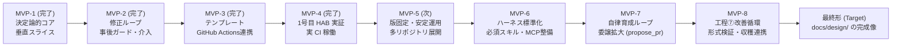

# MVP 成長プラン（ロードマップ）

この文書は、ソフトウェアガーデンを小さな決定論的コア（MVP-1）から段階的に育て、[概要設計書](../design/overview.md) および [詳細設計書](../design/detailed-design.md) に描く**最終形**へ到達させるための成長プランである。

現在の実装範囲と割り切りについては [現在の MVP 設計](current-mvp.md) を参照する。

---

## 1. 育て方の原則

1. **決定論的な品質ゲートを先に固める。** 自動化やエージェントの自律性を広げる前に、承認済み仕様の照合、2 層判定（失敗と判定不能の区別）、事後ガードなどの安全境界を機械的に強制できるようにする。
2. **1 つの仕事と 1 つの対象リポジトリで一周させてから広げる。** 抽象的な汎用化を先行せず、実対象リポジトリで実証できた仕組みをテンプレートへ還元する。
3. **必須の道具立て（スキル・MCP・ハーネス）をそろえてから自律編集を解放する。** 実エージェントに修正を任せる前に、必要なスキルと MCP サーバーの宣言・導入・診断を標準化し、再現できる実行基盤を固める。
4. **委譲範囲は段階的に広げる。** `observe_only`（観測と検証のみ）から始め、証拠と実績を積み上げてから `propose_pr`（許可範囲での修正と証拠付き PR 提案）、条件付き `auto_merge`（事前承認範囲での自動取り込み）へ権限を広げる。

## 2. 成長ロードマップ全体像

### 段階ごとの広がり

| 段階 | 状態 | 対象リポジトリ | 既定の委譲モード | 主な到達点 |
| --- | --- | --- | --- | --- |
| **MVP-1〜3** | 完了 | フィクスチャ・ナーサリー自身 | `observe_only`（テストでは `propose_pr` も検証） | コアエンジン、事後ガード、4 型テンプレート、再利用ワークフロー、形式検証基盤 |
| **MVP-4** | 完了 | 1 号目（HAB: CLI 型） | `observe_only` | 実対象での 3 条件実証と実 GitHub Actions 継続稼働 |
| **MVP-5** | 次の段階 | 複数型（Web / API / Library 追加） | `observe_only` | タグ付き版固定（`v0.1.0`）、運用ハードニング、複数ガーデン横断監視 |
| **MVP-6** | 計画 | 共通の開発ハーネス＋対象固有のハーネス | `observe_only` | 必須スキル・必須 MCP の宣言スキーマ、`garden doctor` 厳格検査、導入導線の標準化 |
| **MVP-7** | 計画 | 実対象リポジトリ群 | `propose_pr`（条件付き `auto_merge` 検証） | 実エージェント修正、`spec-diff` 起点再検証、工程⑥ `reflect` 実運用 |
| **MVP-8** | 計画 | 複数ガーデンとナーサリーの循環 | `propose_pr` / `auto_merge` | 介入知見のテンプレート還元（`v2`）、形式検証の横展開、結実から収穫への連携 |
| **最終形** | 目標 | 全管理対象リポジトリ | 仕事ごとの委譲ポリシー | 日常変更はイベント起点で結実まで自律進行し、人は仕様・収穫・例外判断に集中する |

---

## 3. 達成済みフェーズ（MVP-1〜MVP-4）

### MVP-1: 決定論的コアと垂直スライス（完了）
- **実装内容**
  - `pyproject.toml` と `src/garden/` のパッケージ化、および `garden.py` 後方互換シム。
  - `.garden/garden.toml` ローダーと厳格バリデーター（委譲厳格化・`forbidden_paths` 強制）。
  - 仕様書のフロントマター解析、`AC-*` / `INV-*` 抽出、信頼できる承認ブランチ（Trust Anchor）照合。
  - `garden doctor` および `garden run`（2 層判定、`run.json` / `step.json` / `summary.md` 生成）。
- **検証済み完了条件**: 正常系 `SATISFIED`（`0`）、挙動不一致 `UNSATISFIED`（`1`）、環境不備・証拠欠損・形式検証未完了 `INCONCLUSIVE`（`3`）、仕様未承認 `NEEDS_HUMAN`（`4`）を結合テストで実証した。

### MVP-2: エージェントアダプター・修正ループ・Worktree 分離・介入記録（完了）
- **実装内容**
  - Agent Adapter 契約（`request.json` / `response.json`）と `codex` / `claude` / `antigravity` / `custom` / `mock` アダプター。
  - 事後ガード（`guard.py` による `forbidden_paths` / `allowed_paths` / `observe_only` / 履歴改変 / コスト・時間上限の検査）。
  - `fix_and_retry` ループ、冪等キーによる重複スキップ、ローカル `git worktree` 隔離と `verified_commit` 永続化。
  - 介入レコード（`garden feedback`）とメトリクス集計（`garden metrics`）。
- **検証済み完了条件**: 許可範囲内修正からの再検証 `SATISFIED`、禁止パス改変の `guard.py` 検知による `NEEDS_HUMAN`、`needs_spec_decision` 時の問い付き `NEEDS_HUMAN` を実証した。

### MVP-3: テンプレート導入・更新と GitHub Actions 連携（完了）
- **実装内容**
  - `harnesses/pstack.toml` と全 4 型のテンプレート（`templates/{cli,web-frontend,http-api,library}/v1/`）。
  - `garden init`、`garden upgrade`（独自設定を保ち新規チェックを `proposed` として提案）、`garden template-gate`（公開ゲート）、`uvx` / `pipx run` によるインストール不要の実行。
  - `garden report`（HTML マーカーによる重複スキップ、ラベル遷移）、`garden reflect`（工程⑥反映ゲート）、`garden status`（複数ガーデンの横断表示）、`/garden feedback` コメント解析、`garden metrics`。
  - 再利用可能ワークフロー（`garden-reusable.yml`）、ナーサリー自己ドッグフーディング、有界全状態形式検証（`python3 .agents/skills/formal-verify-garden-engine/scripts/verify_invariants.py` で 8 不変条件・61,842 状態を検証）。

### MVP-4: 1号目の実対象リポジトリ接続と完了判定 3 条件（完了）
1 号目の実対象リポジトリとして HAB（`s-hiraoku/hiraoku-agent-base`）へ `templates/cli/v1` を導入し、カタログへ登録したうえで、最初の到達点となる次の 3 条件を実証した。

- **実装内容**（HAB のローカル実証の後、実 GitHub Actions での完了判定までに追加したもの）
  - 再利用ワークフローの Node 準備、`garden register`（カタログ登録）、`garden spec-diff`（承認済み仕様との条件単位差分）。
  - 再利用可能な介入記録ワークフロー（`garden-feedback-reusable.yml`、`open_pr: true` による PR 永続化を含む）。
  - `garden init --nursery-ref` と再利用ワークフローの `nursery_ref` による版固定、非公開ナーサリー向けの `secrets.nursery_token`、`python3 -m garden`、自己ドッグフーディングの `reusable-smoke` ジョブ。
  - `garden report` のラベル自動作成と Workflow Artifacts URL の表示。

| 完了条件 | 確認したこと | HAB での実証結果 |
| --- | --- | --- |
| **1. 普段の確認を任せられる** | 定義した事象から実行が始まり、人が同じ操作をやり直さずに証拠から判断できる | ローカル（`pull_request` / `opened`）および実 GitHub Actions（PR #291・`workflow_dispatch`）で `SATISFIED` と結実通知を確認した |
| **2. 問題時に判断を引き継げる** | 挙動不一致と環境不備による判定不能を区別し、観測事実と未確認段階を渡せる | 回帰注入で `UNSATISFIED`、Node バージョン不備で `INCONCLUSIVE` を明確に区別した |
| **3. 人の手直しが次に効く** | 介入レコードから切り分け手順を対象固有のハーネスへ取り込み、再発時に根拠付きで報告できる | 介入記録後に対象固有のハーネス v2 で `toolchain-diagnostic.json` を出力し、再実行で原因を証拠付き報告、`verified_rate = 1.0` を確認した |

- 実証記録の詳細: [HAB での MVP-4 実証記録](evidence/mvp4-hab/README.md)

---

## 4. 今後の成長フェーズ（MVP-5〜MVP-8 と最終形）

### MVP-5: 安定運用と多リポジトリ展開（次の段階）
- **目的**: ナーサリーの配布・版管理と運用信頼性を固め、CLI 以外の型を含む複数リポジトリで日常的に継続稼働させる。
- **主な取り組み**
  1. **ナーサリーの版固定リリース運用（`v0.1.0` 発行済み）**: 初回タグ（`v0.1.0`）を発行し、対象リポジトリの `garden init --nursery-ref v0.1.0` および再利用ワークフローのタグ固定運用を標準化する。
  2. **報告・ラベル運用のハードニング（4 件実装済み、`garden:running` 開始時付与と実 CI 再現確認待ち）**:
     - `garden report` で新ラベル追加失敗時に旧ラベルを削除しない安全なラベル遷移へ改める。
     - 同一 PR の `auto` と `/garden resume` に同じ `concurrency.group` を使い、ラベル更新を直列化する。グループはリポジトリと Issue/PR 単位とし、`queue: max` で複数の待機ジョブを保持する。
     - 過去実行の再表示時に無関係な Actions URL が混入しないよう、`artifacts_url` は `garden run` の記録作成時のみ解決する。
     - 既存ラベルの色と説明を上書きしないよう `gh label create` から `--force` を外す。
     - 実行開始時に `garden:running` を付け、終了時の報告で外す。
  3. **2 号目以降の対象リポジトリ接続（`kobitokey-studio`・`shift-log` ローカル実証済み、実 Actions 確認待ち）**: `kobitokey-studio`（`web-frontend/v1`）と `shift-log`（`http-api/v1`）へ `@v0.1.0` 固定で導入し、カタログ登録と GitHub Actions 継続稼働を確認する。
  4. **対象固有のハーネス改善**: HAB のデモスクリプトで失敗段階の構造化 JSON を出力するなど、MVP-4 で挙がった改善候補を工程⑦サイクルで反映する。
  5. **複数ガーデンの横断監視**: `garden status` を定常運用し、全対象リポジトリの診断結果・テンプレート版・直近判定を一望できるようにする。
- **完了条件**
  - タグ固定（`v0.1.0` 以降）で 2 つ以上の異なる型の対象リポジトリが GitHub Actions 上で継続稼働している。
  - 上記 5 件の報告・ラベル運用ハードニングが回帰テスト付きで解消されている。
  - 旧コミットの `auto` 実行中に、新コミットの PR 検証が待機し、その後に `/garden resume` が入るケースを再現する。新コミットの必須チェックが取り消されずに実行され、合格できることを確認する。
  - `garden status` でナーサリー自身と登録済み全ガーデンの状態が正確に集約される。

### MVP-6: ハーネス標準化（必須スキル・必須 MCP の定義と検証）
- **目的**: 実エージェントに自律的な実装・修正を委譲する前提として、共通の開発ハーネスと対象固有のハーネスに必要なスキルおよび MCP サーバーを明示的に定義し、機械的に診断・準備できる基盤を整える。
- **主な取り組み**
  1. **必須スキル・必須 MCP の宣言スキーマ整備**: [詳細設計書 §7.2](../design/detailed-design.md#72-共通の開発ハーネスpstackマニフェストharnessespstacktoml) の分担に従い、`harnesses/pstack.toml` の `[skills].core` を全ガーデン共通の必須スキルとして扱い、`.garden/garden.toml` の `[common_harness].required_skills`・`[target_harness].required_skills`・`[target_harness].required_mcp`（接続確認方法・版固定方針を含む）を読み込んで検査できるようにする。
  2. **`garden doctor` と Preflight の厳格化**: 必須スキルや必須 MCP が未導入または未接続の場合、単なる `warn` ではなく `doctor` では `error`、実行前検査では `INCONCLUSIVE` として検出し、不足物と導入手順を明示する。
  3. **導入導線と再現性の整備**: 共通の開発ハーネス（pstack）や必須スキル・MCP 設定を、ローカル環境（Antigravity / Cursor / Claude Code / Codex）および CI 環境へ再現性高く導入できる補助コマンド・設定ガイド・プラグイン連携を整える。
  4. **テンプレート別のハーネス標準パターン策定**: `cli`、`web-frontend`（ブラウザ操作系 MCP / Playwright 等）、`http-api`、`library` の型ごとに、標準の必須スキル・MCP と対象固有のハーネス構成をテンプレートへ組み込む。
- **完了条件**
  - `.garden/garden.toml` で `required_skills` と `required_mcp` を宣言でき、欠損環境では `garden doctor` が終了コード `1`、不足解消後は終了コード `0` を返すことを単体・結合テストで実証する。
  - 2 つ以上の実対象リポジトリで、手元と CI の両方で同じ必須スキル・必須 MCP 要件を診断できる。

### MVP-7: 自律育成ループと委譲拡大（`observe_only` から `propose_pr` へ）
- **目的**: 検証して報告するだけのガーデンから、標準化されたハーネス上で許可範囲を修正し、再検証し、証拠付き PR を提案できるガーデンへ成長させる。
- **主な取り組み**
  1. **実エージェントによる `fix_and_retry` 実証**: `codex`、`claude`、`antigravity` のいずれかの実プロバイダーで、失敗検知、隔離ワークツリーでの修正、事後ガード検査、再検証 `SATISFIED` までを実対象リポジトリで通す。
  2. **工程⑥ `garden reflect` の実運用**: `propose_pr` モードで `verified_commit` から PR を自動作成し、必須チェック通過・ベース祖先・エージェント差分一致の安全条件を満たす運用を確立する（条件付き `auto_merge` も小範囲で検証する）。
  3. **仕様改定フローの自動化**: 承認済み仕様が更新された際に `garden spec-diff` で影響チェックとフローを抽出し、影響範囲の再検証と孤立チェックの検出をワークフローへ組み込む。
  4. **仕事の分割と着手順**: [詳細設計書 §4.5](../design/detailed-design.md#45-仕事の分割と着手順) に沿って、追跡 Issue の `garden:ready` から `plan.json` を生成・検証し、`garden:work` Issue の作成、人の優先指定（`garden:priority`）、一時停止（`garden:paused`）、仕様改定時の部分的な計画し直しを実装する。
  5. **コスト・時間・権限ガードの実運用チューニング**: 実際のトークン消費、所要時間、エスカレーション頻度を実行記録から観測し、上限値と委譲範囲の標準ガイドラインを整える。
- **完了条件**
  - 1 つ以上の実対象リポジトリで、意図した軽微な不具合から修正、ガード検証、再検証 `SATISFIED`、証拠付き PR 提案までが人手なしで完走し、仕様判断が必要なケースでは `NEEDS_HUMAN` へ安全に停止することを実証する。
  - `propose_pr` と `auto_merge` では、既定設定とフロー上書きの両方で空の `allowed_paths` が設定エラー（終了コード `2`）になることを確認する。

### MVP-8: 工程⑦の改善循環・形式検証の深化・収穫連携
- **目的**: 一つのガーデンで得た知見が他のガーデンを強くする循環（工程⑦）を回し、形式検証と結実から人の収穫（リリース）までの流れを定着させる。
- **主な取り組み**
  1. **知見の共通テンプレート還元（`v1` から `v2` へ）**: 複数ガーデンの介入レコード（`/garden feedback`）と `garden metrics` から共通の失敗パターンを抽出し、`template-gate` の公開条件を満たした `v2` テンプレートを公開して既存ガーデンへ `garden upgrade` で適用する。
  2. **形式検証の横展開**: ナーサリー自身で実績のある有界探索に加えて、対象リポジトリの重要な不変条件（状態遷移、データ整合、プロトコル等）に TLA⁺ / Quint / Lean 4 / 有界探索を適用し、`formal.json` による証拠付き検証を広げる。
  3. **結実から収穫（リリース）への接続**: [詳細設計書 §6.5](../design/detailed-design.md#65-結実の単位と判定する版) に沿って、結実を PR 単位から機能（仕様）単位に移し、承認ブランチ上の統合版で `spec_results` を判定して追跡 Issue に通知する。結実通知（`garden:harvest-ready`）を受けた人が完成を判断し、リリースおよびデプロイ後検証（カナリア確認、配布物インストール確認など）へ進める標準手順をテンプレートに組み込む。
- **完了条件**
  - 実運用の介入レコードから導かれた改善が、公開ゲートを通過した新版テンプレートとしてリリースされ、既存ガーデンが独自設定を壊さずに `garden upgrade` で取り込めている。
  - 複数の対象リポジトリで、工程⑦のメトリクス（介入解消率・再発率）が継続的に追跡されている。

### 最終形（Target Architecture）
[ソフトウェアガーデン概要設計書](../design/overview.md) および [ソフトウェアガーデン詳細設計書](../design/detailed-design.md) が定義する到達状態である。

- 日常の変更や定期確認は、イベントを起点に検証、許可範囲での修正、反映まで自律的に進む。
- 仕様を満たした機能・改善は証拠付きで**結実**が通知され、人は仕様の決定、**収穫**（リリース判断）、例外対応を担う。
- 複数ガーデンの介入記録と再発防止チェックが公開ゲート経由でナーサリーのテンプレートと共通の開発ハーネスへ還元される。

---

[リポジトリ概要](../../README.md) · [現在の MVP 設計](current-mvp.md) · [概要設計書](../design/overview.md) · [詳細設計書](../design/detailed-design.md) · [使い方](../guides/usage.md) · [用語集](../../GLOSSARY.md)
