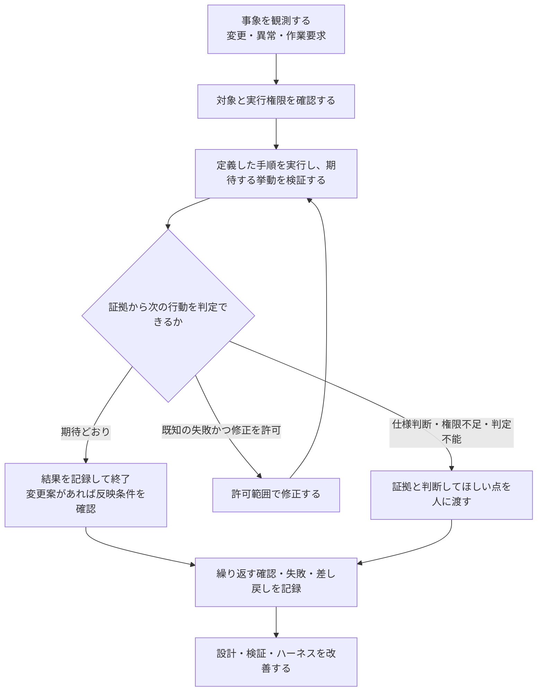

# ソフトウェアガーデン設計書

## 1. 最終目的

**人が繰り返している開発・検証・判断を仕組みに移し、日常の変更はイベントを起点に検証と反映まで進み、事前に定めた条件で扱えないことが起きたときに人が判断できる状態をつくる。**

ソフトウェアガーデンは、この運用を既存のリポジトリに根づかせる仕組みである。対象に合ったハーネスを適用し、何を任せるか、何を成功と判定するか、どの条件で人に戻すかを明示する。そこで人が繰り返し行う確認や判断は、次回にも効く設計・検証・ルールへ移す。

最終状態の判断基準は、同じ種類の仕事が人の立ち会いなしで繰り返し完了し、例外時には人が証拠から判断を始められること。自律化の範囲を広げるときも、品質の悪化や不要な再実行を実行記録から検出できるようにする。

## 2. 任せる仕事の定義

一つの仕事を委譲するときは、次の項目をバージョン管理する。

| 項目 | 決めること |
| --- | --- |
| 目的と期待する挙動 | 利用者や運用者から見て何が成立すればよいか。根拠にする仕様やシナリオはどれか。 |
| 起点 | 何を観測するか。その事象が確認、修正、再検証のどれを始める理由になるか。 |
| 操作と権限 | どの環境、リポジトリ、対象バージョンで、何を読み、どこまで変更・反映してよいか。 |
| 判定と証拠 | 実際の挙動をどう観察し、成功・失敗・判定不能をどう区別するか。どの証拠を残すか。 |
| 例外と終了 | 再実行できる条件、時間や回数の上限、人に必要な判断、完了として扱う状態。 |

### 庭を始めるときに渡す仕様（案）

製品の仕様の正本は、製品とともに変更履歴をたどれるよう、植物リポジトリで管理する。庭の初期設定では、既存の仕様があればその場所を指定する。新しく始める場合は、例えば植物リポジトリの `docs/specs/` に、誰のどんな目的を実現するか、最初の受入条件、守るべき不変条件を書いた仕様案を置く。

人が初版を承認したら、庭はその版を参照して実装と検証を始める。各実行の記録には、実際に使った仕様の版を残す。拠点が提供するのは仕様を書くためのひな型で、検証をいつどう実行するかは各庭のフローで設定する。

### 仕事の優先順位

着手できる機能・改善が複数あるとき、どれから取り組むかはエージェントが決める。人による優先順位の指定は任意とする。人が「この機能を先に」と明示した場合はその指定に従い、指定のない仕事の順序はエージェントが決める。

### 承認済みの仕様を仕事に分ける

人が一つの機能の受入条件と委譲範囲を承認したら、庭はその範囲で仕事を分け、順番を決める。途中で仕事を分割・統合したり、順番を変えたりする判断も庭に任せる。分け直した後も、人が各仕事から対応する受入条件をたどれるようにする。

例えば「下書きを別の端末でも再開できる」という機能なら、保存と復元を別々に進めるか、一緒に実装するかは庭が決める。二台で同時に編集した場合の振る舞いが仕様から決まらないときや、委譲範囲を広げる必要があるときは、その判断に依存する仕事を保留して人に戻す。

### 育成中に仕様が変わったとき

変更案を検討している間、庭は現在の承認済み仕様で仕事を続ける。大きな方針転換で手戻りが見込まれる場合は、人がその機能の育成を一時停止できる。

人が新版を承認したら、庭は受入条件の差分から影響を受ける仕事を見直す。新版でも使える実装を引き継ぎ、変更が必要な箇所を修正して再検証する。例えば下書き保存の仕様に「別の端末でも再開できる」が加われば、入力画面を生かしつつ保存方法を見直し、ページを開き直す場合と別端末で再開する場合の両方を確かめる。

## 3. 実行の流れ

### 基本機能の見取り図

| 工程 | 人が決めること | ガーデンに任せること | 次に渡す根拠 |
| --- | --- | --- | --- |
| ① 仕事の発見・受付 | 受け付ける信号と着手条件 | 信号を受け、重複と対象を照合する | 起点、対象、受付理由 |
| ② 仕様化 | 誰の何を実現するか、受入条件、不変条件、委譲範囲を決め、新規の仕様と更新案を承認する | 既存の仕様を照合し、曖昧な点を質問して仕様案をまとめる | 実装と検証に使う、承認済みの仕様と委譲範囲の版 |
| ③ 実行管理 | 実行権限と再試行の条件・上限。優先順位の指定は任意 | エージェントが着手順を決め、人の明示指定があれば従う。委譲範囲で仕事を分け、対象の版・権限を確認して作業環境を用意する | 各仕事と受入条件の対応、実行記録、対象・仕様・ハーネスの版 |
| ④ 調査・実装・修正 | 仕様から決まらない挙動や作業範囲の変更 | 再現、調査、実装、許可範囲での修正 | 再現手順と調査結果、変更があれば差分とコミット |
| ⑤ 検証 | 受入条件ごとに必要な観測と検証の前提 | 同じ版で必須チェックと挙動の確認を行い、成否と判定不能を記録する | 受入条件ごとの判定、実行結果、検証した範囲 |
| ⑥ 反映・再修正・人への引き渡し | 自動反映できる範囲、例外への対応、完成と出荷 | 証拠と反映条件を照合し、取り込み、再修正、引き渡しのいずれかへ進む | 反映記録、または成果物・証拠・人に求める判断 |
| ⑦ 工程そのものの改善 | 改善を採用し、どの庭に適用するか | 介入や手戻りの理由を調べ、改善案を以前の事例で検証する | 未解決の課題とその観察記録、改善を試した場合は前後の結果と適用条件 |

定型作業では、②で承認済みの仕様と委譲範囲を参照する。引き渡し後に人が既存の受入条件との不一致を見つけた場合は、条件を確認して④で修正する。新たに分かった期待は②で仕様にする。

形式検証を使う場合は、TLA⁺ や Quint のモデルで検査した不変条件と状態範囲や、Lean 4 で証明した命題と仮定を残す。対応する製品版の実際の挙動は、実行時の証拠で確かめる。

### 収穫を知らせる単位

収穫の単位は、人が受入条件を定めた一つの機能または改善とする。一つの機能を複数のイシューや PR に分けた場合、途中の変更は委譲範囲内で取り込める。庭は、それらを組み合わせた製品の版で、その機能について直近に承認された仕様の受入条件をすべて確かめる。条件を満たしたとき、その版の成果物と条件ごとの証拠を添えて「収穫できます」と人に知らせる。

人は成果物を使って完成を判断し、どの機能・改善をまとめて出荷するかを決める。

### 一つの仕事の実行と判定

- 同じ事象の再送を識別し、同じ対象と版の実行結果を追跡できるようにする。起動結果が不明なら、実行先の状態を照合して重複を防ぐ。
- 期待する挙動との不一致と、環境不備などによる判定不能を分けて記録する。再実行では、失敗原因と対象の版を確認する。上限に達した場合は人に引き渡す。
- 反映は、承認済みのポリシーが対象と変更の範囲を許可し、その版に対する必須チェックが有効で、対象側の保護ルールも満たしたときに自動で行える。変更や評価対象が更新されたら判定し直す。ポリシー外の判断は人に渡す。

### 問題や新しい検討事項が見つかったとき

| 状況 | 庭の動き |
| --- | --- |
| 期待する挙動が決まっており、委譲範囲で直せる | 現象を再現して修正し、同じ受入条件で再検証する。上限まで試しても解決できない場合は、試したことと結果を人に渡す。 |
| 検証環境やハーネスの問題で、製品の挙動を確認できない | 該当の検証を「判定不能」と記録する。その証拠を必要とする反映や収穫は保留し、復旧したら対象の版で検証し直す。 |
| 仕様や権限について新しい判断が要る | 判断に依存する仕事を保留し、その庭で決定できる人に知らせる。独立した仕事は継続する。 |
| 現在の受入条件に影響しない改善案が出た | 次の仕事の候補として記録し、今の機能は承認済みの仕様で進める。 |

判断を求めるときは、元のイシューなど、その庭で後から参照できる場所に「対象の機能と版」「観察した事実・証拠」「保留している仕事」「決めてほしい問い」を残す。例えば複数端末で下書きを編集できるようにする途中で競合時の挙動が決まっていなければ、「双方の編集を残すか、後の保存を優先するか」と、それぞれの利用者への影響を示す。回答を同じ場所に記録し、仕様が変わる場合は新版の承認後に該当の仕事を再開する。

問題が共通ハーネスやテンプレートに関わる場合は、その版、再現条件、影響範囲を拠点に持ち帰れる。庭の自動実行が止まっている間も、人が同じ場所に課題を記録できる。

## 4. ガーデン、ハーネス、実行基盤の責務

対象リポジトリにハーネスを適用した庭は、拠点の GitHub リポジトリから独立して仕事を進める。各庭は工程ごとに、拠点が推奨するスキル、外部プラグインのスキル、製品固有のスキルを選べる。例えば、仕様を詰める対話には Matt Pocock の `grill-with-docs`、形式検証の手順を整える場面には pstack の `create-formal-verification-skill` が候補になる。承認を待つ間の実行の扱いも各庭で選べる。

| 管理場所 | 持つもの |
| --- | --- |
| 対象リポジトリ | 製品が満たすべき仕様と検証シナリオ、選んだハーネスの版、固有のコマンドや許可範囲。 |
| ジャンル別ハーネス | 用途ごとに再利用できる環境要件、品質ゲート、挙動の検証方法、調査や引き渡しのスキル。 |
| 共通の実行基盤 | 版の指定と適用、診断、イベントの受け付け、実行と状態の記録、判定と引き渡しの共通形式。 |

対象の仕様と、その仕様を検証した証拠を対応づける。評価条件を変更する作業では、その差分を明示し、変更作業から独立して承認された条件で評価する。環境診断と品質ゲートは、手元と自動実行で同じ定義を参照する。

## 5. 信頼と改善

Poteto Pyramidに沿って、繰り返す問題を見つけたら、まずAPIや構造で誤りを起こしにくくする。残る違反は型、lint、テストなどの決定的なチェックで検出する。実際の挙動は観察可能なシナリオで確認する。文脈を読んで判断する手順はスキルに残す。

実行記録には、起点、対象の版、使った仕様・ポリシーの版、結果、失敗箇所、証拠、所要時間、人が介入した理由を残す。改善の判断には、人が繰り返し介入した理由と回数、同じ問題の再発、誤った反映や取り消しを使う。

各庭からは、未解決の課題も拠点に持ち帰れる。例えば、同じ判断で何度も人を呼んだ場面を共有すると、拠点で他の庭の経験と照らし合わせられる。共通テンプレートに改善を取り込むのは、元の庭で得られた効果と、他の庭でも使える条件を確かめたときとする。知見を届ける方法は、人が後から持ち寄る方法と、利用中の庭から提案する方法を候補とする。

## 6. 最初の到達点と完了判定

最初に、**人がすでに繰り返していて、期待する結果を明文化できる仕事を一つ**選ぶ。その仕事の実行と検証から、証拠付きの判定と例外の引き渡しまでを委譲する。具体的な対象、技術スタック、起動サービスは、選んだ仕事を検証できるものを適用時に選ぶ。

最初の庭は、次の三つを同じ仕事で実証したときに完了とする。送受信確認を任せる場合の例は、共有された年表に基づく。[Software Factory の変遷](https://github.com/s-hiraoku/hiraoku-software-garden/blob/d67ba9412a3d186387600566ce468e981eddb562/docs/references/software-factory-timeline.md)

| 完了条件 | 確認すること | メッセージ送受信の例 |
| --- | --- | --- |
| 普段の確認を任せられる | 定義した事象から実行が始まり、人が同じ操作をやり直さずに結果を判断できる。 | 変更をきっかけに検証用メッセージを送り、対象の版と、そのメッセージへの返信を記録する。 |
| 問題時に判断を引き継げる | 挙動の不一致と、環境不備による判定不能を区別し、観測した事実と人に必要な判断を渡す。 | 意図的に返信を途切れさせ、送信・受信・起動・返信のうち、どこまで確認できたか、何が未確認かを示す。 |
| 人の手直しが次に効く | 人が追加で行った切り分けを手順やチェックに取り込み、同じ状況を再現して、次回は庭が判断材料を返せることを確かめる。 | 初回は人がログを読んで起動の有無を調べたなら、同じ状況で再実行し、庭の報告から起動の有無と根拠をたどれることを確認する。 |

次に、同じ仕事で失敗箇所の特定や修正をどこまで委譲できるかを広げ、その種類の変更を自動で反映できる条件を検証する。

## 参考資料

- StrongDM は仕様とシナリオで実装と検証を繰り返す事例を公開している。ガーデンでは、⑤の判定を人が承認した受入シナリオに結びつける。[StrongDM Software Factory](https://factory.strongdm.ai/)
- OpenAI の Harness Engineering では、エージェントがアプリを起動して実際の挙動を確かめる。Symphony の仕様はチケットごとの作業環境と実行状態を定義する。ガーデンでは③で実行を管理し、④と⑤で同じ対象の版を追跡できるようにする。[Harness Engineering](https://openai.com/index/harness-engineering/) · [Symphony の仕様](https://github.com/openai/symphony/blob/be10a1b79df723d6d7612b5651c8522704dafb2e/SPEC.md)
- Matt Pocock は、イシューや定期実行などのきっかけで一種類の作業を起動するところから始める例を示している。ガーデンでも①と③を、成果を確認できる定型作業一つからつなぐ。[AI Coding Dictionary](https://www.aihero.dev/ai-coding-dictionary/software-factory)
- Claude Code Action の例では、PR レビューと定期保守に異なる起動条件と書き込み権限を設定する。ガーデンでは①の受付条件と③の実行権限を仕事ごとに定義する。[Claude Code Action の自動化事例](https://github.com/anthropics/claude-code-action/blob/acfe7992852970efb4fee683d63d628e3e52df67/docs/solutions.md)
- Warp はワークフローをコードで定義し、評価やベンチマークで改善する方法を公開している。ガーデンでは⑦で改善の効果を以前の事例で確かめ、適用条件とともにハーネスの版に残す。[Warp Factories](https://github.com/warpdotdev/warp/blob/f8223cef2d167a5858bf233df8a1fb6f74537fa5/README.md#automate-development-with-warp-factories)
- Lauren Tan は、繰り返す指摘を構造や決定的なチェックに落とし込み、アプリを実行して挙動を確認する実践を講演で紹介している。ガーデンでは⑦で人の介入を再発防止につなげ、⑤でその効果を確かめる。[Lauren Tan の講演資料](https://github.com/s-hiraoku/hiraoku-software-garden/blob/d67ba9412a3d186387600566ce468e981eddb562/docs/references/sources/all-code-is-slop/README.md)
- [Software Factoryの変遷と、確認・判断を委譲する考え方](https://github.com/s-hiraoku/hiraoku-software-garden/blob/d67ba9412a3d186387600566ce468e981eddb562/docs/references/software-factory-timeline.md)
- [仕様をつくる人の役割と形式検証](https://github.com/s-hiraoku/hiraoku-software-garden/blob/d67ba9412a3d186387600566ce468e981eddb562/docs/references/specification-and-formal-verification.md)
