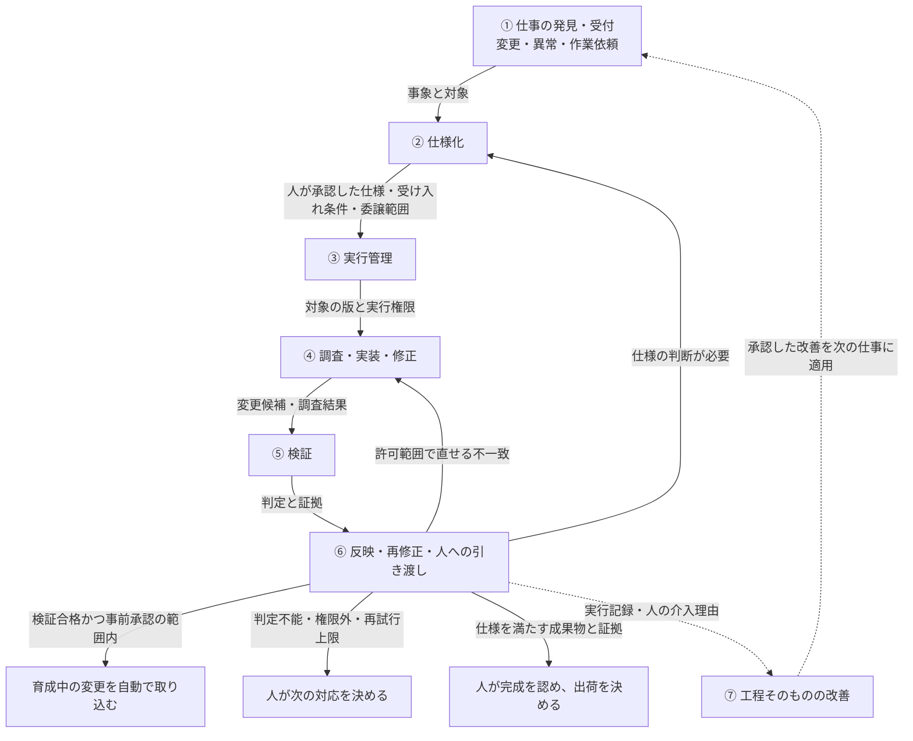

# ソフトウェアガーデン設計書

## 1. 最終目的

**人が繰り返している開発・検証・判断を仕組みに移し、日常の変更はイベントを起点に検証と反映まで進み、事前に定めた条件で扱えないことが起きたときに人が判断できる状態をつくる。**

ソフトウェアガーデンは、この運用を既存のリポジトリに根づかせる仕組みである。対象固有のハーネスを整え、何を任せるか、何を成功と判定するか、どの条件で人に戻すかを明示する。そこで人が繰り返し行う確認や判断は、次回にも効く設計・検証・ルールへ移す。

最終状態の判断基準は、同じ種類の仕事が人の立ち会いなしで繰り返し完了し、例外時には人が証拠から判断を始められること。自律化の範囲を広げるときも、品質の悪化や不要な再実行を実行記録から検出できるようにする。

## 2. 任せる仕事の定義

製品に期待する振る舞いは、製品の利用者の立場で仕様に記す。ガーデンの運用担当者は、どの仕事をガーデンに任せるかを設定する。仕様の承認や完成・出荷の判断は、それぞれの決定を担う人が行う。

一つの仕事を委譲するときは、次の項目をバージョン管理する。

| 項目 | 決めること |
| --- | --- |
| 目的と期待する挙動 | 製品を使う人や運用する人から見て何が成立すればよいか。根拠にする仕様やシナリオはどれか。 |
| 起点 | 何を観測するか。その事象が確認、修正、再検証のどれを始める理由になるか。 |
| 操作と権限 | どの環境、リポジトリ、対象バージョンで、何を読み、どこまで変更・反映してよいか。 |
| 判定と証拠 | 実際の挙動をどう観察し、成功・失敗・判定不能をどう区別するか。どの証拠を残すか。 |
| 例外と終了 | 再実行できる条件、時間や回数の上限、人に必要な判断、完了として扱う状態。 |

### ガーデンごとのトリガー設定（案）

トリガーは「どの出来事を受けて、どの条件で、どの仕事を始めるか」というガーデンごとの設定である。テンプレートが候補を提示し、ガーデンを始めるときに運用担当者が使うものを選ぶ。対象リポジトリに導入する方式では、採用した設定を対象リポジトリの `.garden/garden.toml`（ガーデン定義）に置く。導入後も一つずつ追加・変更・停止できる。

| きっかけ | 条件の例 | 始める仕事の例 |
| --- | --- | --- |
| イシュー作成 | 対象リポジトリに新しい依頼が届いた | 依頼を受け付け、既存の仕様と照合する |
| ラベル付け | 着手用ラベルが付き、対応する仕様の版が人に承認されている | その仕様に沿って実装と検証を始める |
| スケジュール | 毎週月曜の午前9時（日本時間）になった | ガーデンで選んだ回帰テストを実行する |
| CI 失敗 | 対象ブランチの必須チェックが失敗した | 失敗箇所を調査し、結果を残す |

ガーデンは条件に合う出来事を受けると、指定されたフローを、その仕事に委譲された範囲で起動する。例えば CI 失敗に対して調査だけを任せたガーデンでは、原因と証拠を返した時点で仕事が完了する。GitHub Actions など、出来事を届ける手段はガーデンの実行環境に合わせて選ぶ。

### ガーデンを始めるときに渡す仕様（案）

製品の仕様の正本は、製品とともに変更履歴をたどれるよう、対象リポジトリで管理する。ガーデンの初期設定では、既存の仕様があればその場所を指定する。新しく始める場合は、例えば対象リポジトリの `docs/specs/` に、誰のどんな目的を実現するか、最初の受け入れ条件、守るべき不変条件を書いた仕様案を置く。

人が初版を承認したら、ガーデンはその版を参照して実装と検証を始める。各実行の記録には、実際に使った仕様の版を残す。ナーサリーが提供するのは仕様を書くためのひな型で、検証をいつどう実行するかは各ガーデンのフローで設定する。

### 仕事の優先順位

着手できる機能・改善が複数あるとき、どれから取り組むかはエージェントが決める。人による優先順位の指定は任意とする。人が「この機能を先に」と明示した場合はその指定に従い、指定のない仕事の順序はエージェントが決める。

### 承認済みの仕様を仕事に分ける

人が一つの機能の受け入れ条件と委譲範囲を承認したら、ガーデンはその範囲で仕事を分け、順番を決める。途中で仕事を分割・統合したり、順番を変えたりする判断もガーデンに任せる。分け直した後も、人が各仕事から対応する受け入れ条件をたどれるようにする。

例えば「下書きを別の端末でも再開できる」という機能なら、保存と復元を別々に進めるか、一緒に実装するかはガーデンが決める。二台で同時に編集した場合の振る舞いが仕様から決まらないときや、委譲範囲を広げる必要があるときは、その判断に依存する仕事を保留して人に戻す。

### 育成中に仕様が変わったとき

変更案を検討している間、ガーデンは現在の承認済み仕様で仕事を続ける。大きな方針転換で手戻りが見込まれる場合は、人がその機能の育成を一時停止できる。

人が新版を承認したら、ガーデンは受け入れ条件の差分から影響を受ける仕事を見直す。新版でも使える実装を引き継ぎ、変更が必要な箇所を修正して再検証する。例えば下書き保存の仕様に「別の端末でも再開できる」が加われば、入力画面を生かしつつ保存方法を見直し、ページを開き直す場合と別端末で再開する場合の両方を確かめる。

## 3. 実行の流れ

### 基本機能の見取り図



| 工程 | 人が決めること | ガーデンに任せること | 次に渡す根拠 |
| --- | --- | --- | --- |
| ① 仕事の発見・受付 | 受け付ける信号と着手条件 | 信号を受け、重複と対象を照合する | 起点、対象、受付理由 |
| ② 仕様化 | 誰の何を実現するか、受け入れ条件、不変条件、委譲範囲を決め、新規の仕様と更新案を承認する | 既存の仕様を照合し、曖昧な点を質問して仕様案をまとめる | 実装と検証に使う、承認済みの仕様と委譲範囲の版 |
| ③ 実行管理 | 実行権限と再試行の条件・上限。優先順位の指定は任意 | エージェントが着手順を決め、人の明示指定があれば従う。委譲範囲で仕事を分け、対象の版・権限を確認して作業環境を用意する | 各仕事と受け入れ条件の対応、実行記録、対象リポジトリ・仕様・対象固有のハーネスの版 |
| ④ 調査・実装・修正 | 仕様から決まらない挙動や作業範囲の変更 | 再現、調査、実装、許可範囲での修正 | 再現手順と調査結果、変更があれば差分とコミット |
| ⑤ 検証 | 受け入れ条件ごとに必要な観測と検証の前提 | 同じ版で必須チェックと挙動の確認を行い、成否と判定不能を記録する | 受け入れ条件ごとの判定、実行結果、検証した範囲 |
| ⑥ 反映・再修正・人への引き渡し | 自動反映できる範囲、例外への対応、完成と出荷 | 証拠と反映条件を照合し、取り込み、再修正、引き渡しのいずれかへ進む | 反映記録、または成果物・証拠・人に求める判断 |
| ⑦ 工程そのものの改善 | 改善を採用し、どのガーデンに適用するか | 介入や手戻りの理由を調べ、改善案を以前の事例で検証する | 未解決の課題とその観察記録、改善を試した場合は前後の結果と適用条件 |

定型作業では、②で承認済みの仕様と委譲範囲を参照する。引き渡し後に人が既存の受け入れ条件との不一致を見つけた場合は、条件を確認して④で修正する。新たに分かった期待は②で仕様にする。

形式検証を使う場合は、TLA⁺ や Quint のモデルで検査した不変条件と状態範囲や、Lean 4 で証明した命題と仮定を残す。対応する製品版の実際の挙動は、実行時の証拠で確かめる。

### 収穫を知らせる単位

収穫の単位は、人が受け入れ条件を定めた一つの機能または改善とする。一つの機能を複数のイシューや PR に分けた場合、途中の変更は委譲範囲内で取り込める。ガーデンは、それらを組み合わせた製品の版で、その機能について直近に承認された仕様の受け入れ条件をすべて確かめる。条件を満たしたとき、その版の成果物と条件ごとの証拠を添えて「収穫できます」と人に知らせる。

人は成果物を使って完成を判断し、どの機能・改善をまとめて出荷するかを決める。

### 一つの仕事の実行と判定


- 同じ事象の再送を識別し、同じ対象と版の実行結果を追跡できるようにする。起動結果が不明なら、実行先の状態を照合して重複を防ぐ。
- 受け入れ条件を判断する証拠が足りないときは「判定不能」と記録する。例えば必須チェックの CLI 結果が `unavailable` なら、そのチェックで確かめる予定だった挙動は未確認となる。実行できても観察結果を失えば、同じく判定不能になる。再実行では、失敗原因と対象の版を確認する。上限に達した場合は人に引き渡す。
- 反映は、承認済みのポリシーが対象と変更の範囲を許可し、反映する版が必須チェックに合格し、対象側の保護ルールも満たしたときに自動で行える。変更や評価対象が更新されたら判定し直す。ポリシー外の判断は人に渡す。

### 問題や新しい検討事項が見つかったとき

| 状況 | ガーデンの動き |
| --- | --- |
| 期待する挙動が決まっており、委譲範囲で直せる | 現象を再現して修正し、同じ受け入れ条件で再検証する。上限まで試しても解決できない場合は、試したことと結果を人に渡す。 |
| 検証環境や対象固有のハーネスの問題で、製品の挙動を確認できない | 該当の検証を「判定不能」と記録する。その証拠を必要とする反映や収穫は保留し、復旧したら対象の版で検証し直す。 |
| 仕様や権限について新しい判断が要る | 判断に依存する仕事を保留し、そのガーデンで決定できる人に知らせる。独立した仕事は継続する。 |
| 現在の受け入れ条件に影響しない改善案が出た | 次の仕事の候補として記録し、今の機能は承認済みの仕様で進める。 |

判断を求めるときは、元のイシューなど、そのガーデンで後から参照できる場所に「対象の機能と版」「観察した事実・証拠」「保留している仕事」「決めてほしい問い」を残す。例えば複数端末で下書きを編集できるようにする途中で競合時の挙動が決まっていなければ、「双方の編集を残すか、後の保存を優先するか」と、それぞれの利用者への影響を示す。回答を同じ場所に記録し、仕様が変わる場合は新版の承認後に該当の仕事を再開する。

問題が共通の開発ハーネスやテンプレートに関わる場合は、その版、再現条件、影響範囲をナーサリーに持ち帰れる。ガーデンの自動実行が止まっている間も、人が同じ場所に課題を記録できる。

## 4. ナーサリー、対象リポジトリ、実行環境の責務

各ガーデンは、ナーサリーの GitHub リポジトリから独立して仕事を進める。共通の開発ハーネスには pstack を使い、製品の仕様に合わせて対象固有のハーネスを整える。各ガーデンは工程ごとに、ナーサリーが推奨するスキル、外部プラグインのスキル、製品固有のスキルを選べる。例えば、仕様を詰める対話には Matt Pocock の `grill-with-docs`、形式検証の手順を整える場面には pstack の `create-formal-verification-skill` が候補になる。承認を待つ間の実行の扱いも各ガーデンで選べる。[Matt Pocock のスキル定義](https://github.com/mattpocock/skills/blob/abeeaf95660ba9e8b7c753eb38f441ca707a8823/skills/engineering/grill-with-docs/SKILL.md) · [pstack の形式検証スキル定義](https://github.com/cursor/plugins/blob/7a583913eb1b8d1a0ee76753d1a2cf072e7b54f9/pstack/skills/create-formal-verification-skill/SKILL.md)

| 管理場所 | 持つもの |
| --- | --- |
| ナーサリー | 対象リポジトリの登録一覧（カタログ）、種類別テンプレート、共通の開発ハーネスを管理する。版の適用、診断、イベントの受付、実行記録と引き渡しに使う共通の手順・ツールを提供する。 |
| 対象リポジトリ | 製品仕様と検証シナリオ、採用した版、対象固有のハーネスとその依存関係、許可範囲を管理する。 |
| 実行環境 | 手元や CI で、チェックアウト・認証・依存パッケージを用意する。対象が採用した版の手順を実行し、状態・判定・証拠を記録する。 |

対象の仕様と、その仕様を検証した証拠を対応づける。評価条件を変更する作業では、その差分を明示し、変更作業から独立して承認された条件で評価する。環境診断と品質ゲートは、手元と自動実行で同じ定義を参照する。

### 対象固有のハーネスの導入（案）

対象固有のハーネスは、採用した育て方のテンプレートとその版、承認済み仕様の参照先、使うスキル、既存の検証手順を結びつける。導入の目安は、対象を開いた人やエージェントが、一つの仕事について仕様をたどり、対応する検証を実行して結果を返せることとする。

第一候補は、ナーサリーが提供する CLI で対象を調べ、選んだ型の設定と手順を対象リポジトリに導入する方式。製品の変更と、その変更をどう確かめたかを同じ履歴で追え、各ガーデンがナーサリーから独立して運用できる。プラグインは Matt Pocock や pstack などのスキルを届ける手段、手元の環境や CI はそのガーデンの手順を実行する場所として組み合わせる。

別案として、専用の作業リポジトリにガーデンの設定を置き、そこから対象を参照する方式もある。対象側に設定を置きにくい場合に使いやすく、設定の版と対象のどの版を組み合わせたかを両者の間で追跡する必要がある。

### ガーデン定義をファイルで共有する

対象リポジトリの `.garden/garden.toml` を「ガーデン定義」と呼ぶ。人とエージェントはこのファイルで対象固有の育て方を共有する。ナーサリー直下の `garden.toml` は、現行の CLI が `[repositories.<id>]` を読む[カタログ](../../garden.toml)である。ファイル配置を分けることで両者の衝突を防ぎ、対象リポジトリ側の実行記録や隔離作業領域も `.garden/` 配下に整理する。ガーデン定義の詳細スキーマ、委譲範囲の検証規則、ステートマシン実行仕様は[ソフトウェアガーデン詳細設計書](detailed-design.md)で定義する。ここには、採用したテンプレートと対象固有のハーネスの版、製品仕様の参照先、仕事を始めるトリガー、呼び出すフロー、検証手順、委譲範囲を記す。製品の仕様本文は対象リポジトリの仕様書で管理する。各回の実行結果には、実際に使ったガーデン定義と承認済み仕様の版を記録する。

下書き保存機能を持つ対象リポジトリのガーデン定義を例にする。ナーサリーから採用したテンプレートと、対象リポジトリで管理するブラウザ検証用ハーネスには、それぞれ名前と版を記す。この例では PR が作成されたときと、追加の push で更新されたときに、対象リポジトリのルートで `npm run test:restore-draft` を実行する。

```toml
[template]
name = "web-typescript"
version = 1

[target_harness]
name = "drafts-browser"
version = 3

[spec]
path = "docs/specs/drafts.md"

[checks]
restore_draft = ["npm", "run", "test:restore-draft"]

[[triggers]]
event = "pull_request"
action = "opened"
flow = "verify_draft"

[[triggers]]
event = "pull_request"
action = "synchronize"
flow = "verify_draft"

[flows.verify_draft]
checks = ["restore_draft"]
```

各チェックは実行ファイル名と引数の配列で指定する。この例では、検証ツールを替えるときに `restore_draft` が呼ぶ手順を更新できる。トリガーやフローからは引き続き同じ検証を指定でき、Git の差分から育て方の変更を追える。

### リポジトリの育て方のテンプレート（案）

ナーサリーは、ソフトウェアの種類に応じて「最初に何を整え、日々の変更をどう確かめ、得た経験をどう次に生かすか」をテンプレートとして提供する。各テンプレートには、代表的な仕事を一つ選び、その起点、推奨スキル、検証の観点、人に渡す成果物と証拠を一組にして載せる。各ガーデンはこれを出発点に、製品の仕様、既存のチェック、委譲する範囲を当てはめる。

ガーデンを始めるとき、導入に使うツールは対象リポジトリの README、ソースの構成、起動手順、既存のテストや CI を参照する。各テンプレートが想定する用途と照らし合わせ、選んだ型とその根拠を示す。用途が読み取れないときは人が指定できる。画面と API が同居するリポジトリでは、対象ごとに型を選べる。

#### 用意するテンプレートの候補

最初の候補は、利用者がどこから製品を使い、何を観察すれば目的を果たせたと分かるかで選ぶ。

| 型 | 対象を見分ける手がかり | 型に含める代表的な検証と証拠 |
| --- | --- | --- |
| Web フロントエンド | ブラウザでの利用案内、画面の実装と起動手順 | 利用者の操作を再現し、期待した表示や状態の変化を実際の画面で確かめる。操作手順と観察結果を残す。 |
| HTTP API | クライアント向けの API 仕様、リクエストを受ける処理 | 代表的な要求と不正な要求を送り、応答とデータの変化を仕様と照合する。要求と観測結果を対にして残す。 |
| CLI | コマンドの利用例、引数や標準入力を受ける処理 | 入力例を実行し、出力・終了状態・生成物を期待値と照合する。再現できる呼び出し方と結果を残す。 |
| ライブラリ | 他のコードから使う公開関数や型、利用側のサンプル | 公開 API を利用側のコードから呼び、承認済みの振る舞いと互換性を確かめる。利用例と結果を残す。 |

各ガーデンでは代表例を人が承認した製品のシナリオに置き換え、既存の画面テストや API テストなどを組み込む。形式検証は、各テンプレートで扱う不変条件に応じて選べる。

#### ガーデンの運用担当者がフローを組み替える

テンプレートの手順を出発点に、ガーデンの運用担当者は工程で使うスキルや検証方法を追加・差し替えできる。どの仕事で、どの時点に実行し、結果に応じてどこへ進むかも選べる。運用担当者は、あるガーデンで作った手順を自分が管理する別のガーデンでも試せる。共通テンプレートへの還元は、他のガーデンでも役立つ条件と検証結果を確かめてから行う。

検証では、確かめたい受け入れ条件に、運用担当者が選んだテストコマンドや検証スキルを結びつける。例えばフロントエンドのガーデンで「保存後にページを開き直しても入力内容が残る」という受け入れ条件がある場合、保存処理を変更したときは、単体テストの後にチームの Playwright シナリオを実行するよう指定できる。

ガーデンは指定された条件でその方法を実行し、対象の版、受け入れ条件、結果と証拠を対応づける。必須の検証が通れば反映条件の確認へ進み、不一致なら許可された範囲で修正と再検証に戻る。検証を実行できなかった場合は判定不能として理由を残す。期待する挙動そのものを変える場合は、②で人が承認した新しい仕様を使う。

ガーデンは、承認済みの受け入れ条件を同じ範囲で確かめた証拠を示せる場合に、委譲範囲内で検証手段を差し替えられる。たとえば下書き保存なら、新しいツールでも保存後に画面を開き直し、入力内容が残ったことを観察する。何を合格とするかが変わる場合は、その条件に依存する反映を保留し、変更する基準を人に戻す。

#### ガーデンでテンプレートを使う流れ

| 場面 | テンプレートを使ってガーデンで行うこと | 確かめること |
| --- | --- | --- |
| ガーデンを始める | 人が守りたい振る舞いを一つ選び、受け入れ条件を承認する。ガーデンでその振る舞いを観察できるようにする。 | 期待どおりの例と、条件を外れた例を見分けられる。 |
| 日々の変更を育てる | 依頼や変更をきっかけに、承認済みの仕様に沿って調査・実装・検証を進める。 | 人が変更の効果と検証の証拠を見て、受け入れるか判断できる。定型の変更は委譲範囲で反映できる。 |
| 育て方を見直す | 人が繰り返した確認や差し戻しを振り返り、そのガーデンの手順やチェックを改善する。 | 同じ場面で改善が効く。他のガーデンでも使えそうな知見や、共通しそうな困りごとをナーサリーに持ち帰れる。 |

例えば CLI 向けの型なら、「変更後も利用者が同じ入力から期待した結果を得られるか」を基本の問いにする。型が示す観点は入力・出力・終了状態で、具体的な入力例と期待値は各ガーデンの仕様で決める。その CLI に検証手順がすでにあれば型に組み込める。

#### テンプレートの版管理と更新

ナーサリーはテンプレートの変更を新版として公開する。各ガーデンは採用したテンプレートと版を対象リポジトリのガーデン定義に記録し、そのガーデンが更新を取り込むまでは同じ版を使い続ける。どの版で検証したかは、実行記録からたどれるようにする。

更新するときは、採用中の版と候補の版の差分を確認し、ガーデン独自の設定や検証手順を保ったまま変更を試す。例えば、新版に「キーボードだけでフォームを送信できるか」という検証が加わった場合、そのガーデンの承認済み仕様を基準に扱いを決める。

- すでに受け入れ条件にある振る舞いなら、既存の検証と追加の検証を実行する。結果を確認でき、更新が委譲範囲に収まれば、ガーデンは新版を採用できる。
- 製品に新たに求める振る舞いなら、ガーデンはその理由を添えて仕様の変更を提案する。人が承認した後に、その検証を合格条件に加える。

#### テンプレートの新版を公開する条件

ナーサリーは新版を公開する前に、新しく始めるガーデンと旧版から更新するガーデンの両方で、変更した手順を試す。キーボード操作の検証を追加した場合は、次の結果を確かめる。

- 新しく始めるガーデンでは、新版を導入して、キーボードでフォームを送信できる例と送信できない例を試す。前者が合格し、後者ではどの操作で失敗したかを結果から特定できることを確かめる。
- 旧版から更新するガーデンでは、ガーデン独自の検証を含む設定で新版を試す。更新後も元の検証が動き、新しい検証を採用するかはガーデン側で選べることを確かめる。

公開時には、変更点とともに、どんなガーデンでどの版を使い、何を試してどんな結果を得たかを添える。各ガーデンはその記録を見て、自分のガーデンで新版を試すか判断できる。

## 5. 信頼と改善

Poteto Pyramidに沿って、繰り返す問題を見つけたら、まずAPIや構造で誤りを起こしにくくする。残る違反は型、lint、テストなどの決定的なチェックで検出する。実際の挙動は観察可能なシナリオで確認する。文脈を読んで判断する手順はスキルに残す。

実行記録には、起点、対象の版、使った仕様・ポリシーの版、結果、失敗箇所、証拠、所要時間、人が介入した理由を残す。改善の判断には、人が繰り返し介入した理由と回数、同じ問題の再発、誤った反映や取り消しを使う。

各ガーデンからは、未解決の課題もナーサリーに持ち帰れる。例えば、同じ判断で何度も人を呼んだ場面を共有すると、ナーサリーで他のガーデンの経験と照らし合わせられる。共通テンプレートに改善を取り込むのは、元のガーデンで得られた効果と、他のガーデンでも使える条件を確かめたときとする。知見を届ける方法は、人が後から持ち寄る方法と、利用中のガーデンから提案する方法を候補とする。

## 6. 最初の到達点と完了判定

最初に、**人がすでに繰り返していて、期待する結果を明文化できる仕事を一つ**選ぶ。その仕事の実行と検証から、証拠付きの判定と例外の引き渡しまでを委譲する。具体的な対象、技術スタック、起動サービスは、選んだ仕事を検証できるものを適用時に選ぶ。

最初のガーデンは、次の三つを同じ仕事で実証したときに完了とする。送受信確認を任せる場合の例は、共有された年表に基づく。[Software Factory の変遷](../references/software-factory-timeline.md)

| 完了条件 | 確認すること | メッセージ送受信の例 |
| --- | --- | --- |
| 普段の確認を任せられる | 定義した事象から実行が始まり、人が同じ操作をやり直さずに結果を判断できる。 | 変更をきっかけに検証用メッセージを送り、対象の版と、そのメッセージへの返信を記録する。 |
| 問題時に判断を引き継げる | 挙動の不一致と、環境不備による判定不能を区別し、観測した事実と人に必要な判断を渡す。 | 意図的に返信を途切れさせ、送信・受信・起動・返信のうち、どこまで確認できたか、何が未確認かを示す。 |
| 人の手直しが次に効く | 人が追加で行った切り分けを手順やチェックに取り込み、同じ状況を再現して、次回はガーデンが判断材料を返せることを確かめる。 | 初回は人がログを読んで起動の有無を調べたなら、同じ状況で再実行し、ガーデンの報告から起動の有無と根拠をたどれることを確認する。 |

次に、同じ仕事で失敗箇所の特定や修正をどこまで委譲できるかを広げ、その種類の変更を自動で反映できる条件を検証する。

## 参考資料

- StrongDM は仕様とシナリオで実装と検証を繰り返す事例を公開している。ガーデンでは、⑤の判定を人が承認した受け入れシナリオに結びつける。[StrongDM Software Factory](https://factory.strongdm.ai/)
- OpenAI の Harness Engineering では、エージェントがアプリを起動して実際の挙動を確かめる。Symphony の仕様はチケットごとの作業環境と実行状態を定義する。ガーデンでは③で実行を管理し、④と⑤で同じ対象の版を追跡できるようにする。[Harness Engineering](https://openai.com/index/harness-engineering/) · [Symphony の仕様](https://github.com/openai/symphony/blob/be10a1b79df723d6d7612b5651c8522704dafb2e/SPEC.md)
- Matt Pocock は、イシューや定期実行などのきっかけで一種類の作業を起動するところから始める例を示している。ガーデンでも①と③を、成果を確認できる定型作業一つからつなぐ。[AI Coding Dictionary](https://www.aihero.dev/ai-coding-dictionary/software-factory)
- Claude Code Action の例では、PR レビューと定期保守に異なる起動条件と書き込み権限を設定する。ガーデンでは①の受付条件と③の実行権限を仕事ごとに定義する。[Claude Code Action の自動化事例](https://github.com/anthropics/claude-code-action/blob/acfe7992852970efb4fee683d63d628e3e52df67/docs/solutions.md)
- Warp はワークフローをコードで定義し、評価やベンチマークで改善する方法を公開している。ガーデンでは⑦で改善の効果を以前の事例で確かめ、適用条件とともに対象固有のハーネスの変更履歴に残す。[Warp Factories](https://github.com/warpdotdev/warp/blob/f8223cef2d167a5858bf233df8a1fb6f74537fa5/README.md#automate-development-with-warp-factories)
- Lauren Tan は、繰り返す指摘を構造や決定的なチェックに落とし込み、アプリを実行して挙動を確認する実践を講演で紹介している。ガーデンでは⑦で人の介入を再発防止につなげ、⑤でその効果を確かめる。[Lauren Tan の講演資料](../references/sources/all-code-is-slop/README.md)
- [Software Factoryの変遷と、確認・判断を委譲する考え方](../references/software-factory-timeline.md)
- [仕様をつくる人の役割と形式検証](../references/specification-and-formal-verification.md)
