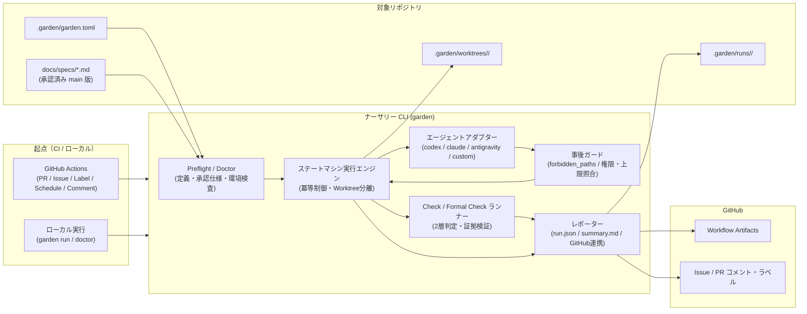
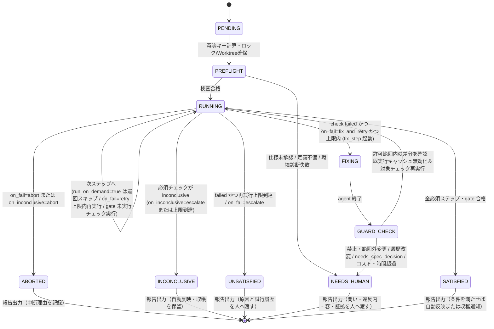

# ソフトウェアガーデン詳細設計書

この文書は、[ソフトウェアガーデン設計書](design.md) の方針と7工程の流れを、そのまま実装と検証に着手できる水準の仕様（アーキテクチャ、ファイル配置、スキーマ、ステートマシン、プロトコル、CLI、マイルストーン）に落とし込んだものです。用語は [用語集](../../GLOSSARY.md) に従います。

> **現在地（実装済みと未実装の区別）**
> - **実装済み（MVP-1〜MVP-3＋実戦投入基盤＋ナーサリー自身のドッグフーディング）**: Python パッケージ構成（`pyproject.toml`・`src/garden/`・互換シム `garden.py`）、カタログ（`list` / `check`）、`.garden/garden.toml` ローダーと厳格バリデーター、仕様パーサーと信頼できる承認ブランチ（既定 `main` / CLI・ワークフロー指定）による Trust Anchor 照合、`garden doctor`、決定論的ステートマシン実行エンジン（`garden run`・`[[triggers]]` 自動解決 `auto`・2層判定・Worktree 分離・ローカル＆GitHub HTML マーカー重複スキップ・`Run Artifacts`）、実プロバイダー対応エージェントアダプター（`codex` / `claude` / `antigravity` / `custom` / `mock`）と事後ガード（`guard.py`）、工程6の反映ゲート（`garden reflect`・既定ドライラン）、介入レコード（`garden feedback`）、`garden report`、`harnesses/pstack.toml`、全4型のテンプレート（`templates/{cli,web-frontend,http-api,library}/v1/`）と `garden init` / `upgrade`、再利用可能 GitHub Actions ワークフロー（`.github/workflows/garden-reusable.yml`）、ナーサリー自身のドッグフーディング構成（`.garden/garden.toml`・`docs/specs/nursery-cli.md`・`.github/workflows/garden-dogfood.yml`・`python-exhaustive` 形式検査統合）、プロジェクトローカル検証スキル（`verify-garden`）および有界全状態形式検証（`formal-verify-garden-engine`・8不変条件）、自動テスト群（`test_garden.py`・`tests/`）。
> - **未実装（今後の対象）**: MVP-4（1号目の実対象リポジトリへの導入と設計書 §6 の3条件実証）、および実 GitHub Actions 環境での `garden-reusable.yml` 実稼働確認。

---

## 1. 全体アーキテクチャとパッケージ構成

### 1.1 実行アーキテクチャ

イベント受付は GitHub Actions（または手元からの手動実行）、実行・判定・記録の中核はナーサリーが提供する単一 CLI（`garden`）が担います。手元でも CI でも同じ CLI コマンドと `.garden/garden.toml` を参照して再現できるようにします。



### 1.2 ナーサリーのディレクトリ構成（実装目標）

Python 3.11 以上を対象とし、標準ライブラリ中心（外部依存は最小限）のパッケージ構成に移行します。既存の `python3 garden.py list` / `check` は、ルート直下の薄いエントリポイント（シム）で後方互換を維持します。なお、`python3 garden.py` 実行時やリポジトリルートからの `unittest` 起動時はルートが `sys.path[0]` に入り、単純な `import garden` では `src/garden/` ではなく `garden.py` 自身を読み込んで衝突するため、シム側で `__path__` に `src/garden/` を公開したうえで `garden.cli:main` へ委譲します。

```text
hiraoku-software-garden/
├── pyproject.toml                  # パッケージ定義 ([project.scripts] garden = "garden.cli:main")
├── garden.py                       # 既存コマンド互換のエントリポイント (garden.cli.main へ委譲)
├── garden.toml                     # カタログ（対象リポジトリの登録一覧）
├── harnesses/
│   └── pstack.toml                 # 共通の開発ハーネス（pstack）の配布マニフェスト
├── templates/                      # 育て方のテンプレート（版ごとに不変ディレクトリ）
│   ├── cli/
│   │   └── v1/
│   │       ├── template.toml       # 検出条件・既定設定・推奨スキル・変更履歴
│   │       ├── garden.toml.tmpl    # .garden/garden.toml の生成雛形
│   │       ├── spec.md.tmpl        # 仕様書のひな型
│   │       ├── workflow.yml.tmpl   # GitHub Actions ワークフロー雛形
│   │       └── release-evidence.json # 新版公開時の新規導入＋旧版更新検証記録
│   ├── web-frontend/v1/
│   ├── http-api/v1/
│   └── library/v1/
├── src/
│   └── garden/
│       ├── __init__.py
│       ├── cli.py                  # argparse ベースのサブコマンド統合
│       ├── catalog.py              # カタログ (garden.toml) の読み込みと list / check
│       ├── definition.py           # ガーデン定義 (.garden/garden.toml) のパースと厳格検証
│       ├── spec.py                 # 仕様書 (YAMLフロントマター・AC/INV) と承認SHA照合
│       ├── doctor.py               # 環境・Git・仕様・pstack マニフェスト診断
│       ├── engine.py               # 宣言的ステップのステートマシン実行と冪等・worktree管理
│       ├── checks.py               # check / formal_check 実行と2層判定
│       ├── guard.py                # forbidden_paths / allowed_paths / 権限・上限の事後検査
│       ├── adapters/
│       │   ├── base.py             # Agent Adapter 契約 (request.json / response.json)
│       │   ├── command.py          # 外部 CLI 呼び出し汎用アダプター (codex/claude/antigravity)
│       │   └── mock.py             # テスト用決定論モックアダプター
│       ├── artifacts.py            # .garden/runs/<run-id>/ の書き出しとスキーマ生成
│       ├── report.py               # summary.md 生成・GitHub コメント/ラベル遷移
│       ├── feedback.py             # 介入レコードの記録と集計
│       └── templates.py            # テンプレート検出・init・upgrade (構造化差分＋オプトイン)
├── tests/
│   ├── test_catalog.py             # 既存 test_garden.py を移行・維持
│   ├── test_definition.py
│   ├── test_spec.py
│   ├── test_engine.py
│   ├── test_adapters.py
│   ├── test_templates.py
│   └── fixtures/                   # 仮想対象リポジトリを用いた結合テスト
└── .github/
    └── workflows/                  # 再利用可能ワークフロー・自リポジトリCI
```

### 1.3 対象リポジトリ側のファイル配置

ナーサリー直下のカタログ（`garden.toml`）と名前が衝突するのを防ぎ、対象リポジトリのルートを散らかさないため、対象リポジトリ側の設定と実行時出力は `.garden/` にまとめます。

```text
<target-repo>/
├── .garden/
│   ├── garden.toml                 # ガーデン定義（Git 管理）
│   ├── .gitignore                  # runs/ と worktrees/ を除外（Git 管理）
│   ├── runs/                       # 実行記録・証拠のローカル出力先（Git 非管理）
│   │   └── <run-id>/
│   ├── worktrees/                  # ローカル実行時の隔離ワークツリー（Git 非管理）
│   │   └── <run-id>/
│   └── interventions/              # 人の介入レコード（任意で Git 管理または Artifacts 保存）
├── docs/
│   └── specs/
│       └── <spec-id>.md            # 仕様書正本（Git 管理、main マージで承認）
└── .github/
    └── workflows/
        └── garden.yml              # トリガーを受けて garden CLI を呼ぶ薄いワークフロー
```

---

## 2. ガーデン定義スキーマ（`.garden/garden.toml`）

### 2.1 完全な記述例

```toml
schema_version = 1

[template]
name = "cli"
version = 1

[common_harness]
name = "pstack"
ref = "7a583913eb1b8d1a0ee76753d1a2cf072e7b54f9"
skills = ["create-verification-skill", "maintain-verification-skill"]

[target_harness]
name = "msg-relay-harness"
version = 1
setup = ["python3", "-m", "pip", "install", "-e", ".[dev]"]

[spec]
paths = ["docs/specs/message-relay.md"]
approval_branch = "main"

[delegation]
mode = "propose_pr"                  # observe_only | propose_pr | auto_merge
allowed_paths = ["src/**", "tests/**"]
forbidden_paths = [".garden/**", "docs/specs/**", ".github/workflows/**"]
max_retries = 2
max_duration_sec = 900
max_cost_usd = 5.0
require_checks = ["unit_test", "relay_e2e"]

[checks.unit_test]
kind = "check"
command = ["pytest", "-q"]
timeout_sec = 180
covers = ["AC-001"]
inconclusive_exit_codes = [75]
status = "active"                    # active | proposed

[checks.relay_e2e]
kind = "check"
command = ["python3", "scripts/verify_relay.py"]
timeout_sec = 300
covers = ["AC-001", "AC-002"]
required_evidence = ["transcript.json"]
inconclusive_exit_codes = [75]
report_path = "report.json"          # $GARDEN_EVIDENCE_DIR からの相対パス
status = "active"

[checks.protocol_model]
kind = "formal_check"
tool = "quint"                       # tlc | quint | lean4
model_path = "formal/relay.qnt"
command = ["quint", "verify", "formal/relay.qnt", "--invariant=no_duplicate_delivery"]
timeout_sec = 300
covers = ["INV-001"]
invariants = ["INV-001"]
status = "active"

[agents.default]
adapter = "codex"                    # codex | claude | antigravity | custom | mock
command = ["codex", "exec", "--sandbox", "workspace-write"]
timeout_sec = 600
max_cost_usd = 2.0

[[triggers]]
id = "pr-verify"
event = "pull_request"
flow = "verify_and_fix"
[triggers.conditions]
actions = ["opened", "synchronize"]

[[triggers]]
id = "scheduled-regression"
event = "schedule"
flow = "verify_only"
[triggers.conditions]
cron = "0 0 * * 1"

[flows.verify_only]
description = "変更を加えず、このフローで実行するチェックの範囲で検証と証拠収集のみを行う"
scope = "flow_checks"                # flow_checks（既定） | all_specs

[flows.verify_only.delegation]
mode = "observe_only"
allowed_paths = []
max_retries = 0

[[flows.verify_only.steps]]
id = "run_unit"
type = "check"
check = "unit_test"
on_fail = "abort"
on_inconclusive = "escalate"

[[flows.verify_only.steps]]
id = "run_e2e"
type = "check"
check = "relay_e2e"
on_fail = "escalate"
on_inconclusive = "escalate"

[[flows.verify_only.steps]]
id = "emit_report"
type = "report"
kind = "auto"

[flows.verify_and_fix]
description = "検証に失敗した場合、委譲範囲内で修正と再検証を最大2回まで試み、全仕様の収穫条件を最終ゲートで確かめる"
scope = "all_specs"

[[flows.verify_and_fix.steps]]
id = "run_e2e"
type = "check"
check = "relay_e2e"
on_fail = "fix_and_retry"
fix_step = "fix_failure"
on_inconclusive = "escalate"
max_retries = 2

[[flows.verify_and_fix.steps]]
id = "fix_failure"
type = "agent"
agent = "default"
purpose = "fix"
skill = "poteto-mode"
run_on_demand = true

[[flows.verify_and_fix.steps]]
id = "final_gate"
type = "gate"
require_checks = ["unit_test", "relay_e2e", "protocol_model"]

[[flows.verify_and_fix.steps]]
id = "emit_report"
type = "report"
kind = "auto"
```

### 2.2 スキーマ検証ルール（バリデーター）

`definition.py` はロード時に以下を決定論的に検証し、1件でも違反があれば設定エラー（CLI 終了コード `2`）で即座に拒否します。

| 対象 | 必須/任意 | 制約 |
| --- | --- | --- |
| `schema_version` | 必須 | 整数 `1` のみ受理。未知の版はエラー。 |
| `[template]` | 必須 | `name`（非空文字列）、`version`（1以上の整数）。 |
| `[common_harness]` | 必須 | `name`（既定 `"pstack"`）、`ref`（40文字小文字16進数 SHA）。 |
| `[target_harness]` | 必須 | `name`（非空文字列）、`version`（1以上の整数）、`setup`（任意の非空文字列配列）。 |
| `[spec]` | 必須 | `paths`（1件以上のリポジトリ相対パス、親参照 `..` 禁止）、`approval_branch`（既定 `"main"`）。 |
| `[delegation]` | 必須 | `mode` は `observe_only` / `propose_pr` / `auto_merge`。`max_retries`（0以上の整数、**フロー全体での累計再試行上限**）、`max_duration_sec`（正整数）、`max_cost_usd`（0以上の数値、**フロー1回あたりの累計コスト上限**）。`forbidden_paths` には実装上つねに `.garden/**` と `[spec].paths` 全件を強制追加する（記述漏れがあっても CLI が自動付与し除外不可）。 |
| `[checks.<name>]` | 1件以上 | `command` は非空文字列配列。`kind` は `"check"` または `"formal_check"`。`status` は `"active"` または `"proposed"`（既定 `"active"`）。`formal_check` では `tool`・`model_path`・`invariants` を必須とする。 |
| `[agents.<name>]` | 任意（`agent` ステップ利用時は必須） | `adapter` は `"codex"` / `"claude"` / `"antigravity"` / `"custom"` / `"mock"`。`command` は非空文字列配列。`timeout_sec`（正整数）。`max_cost_usd`（任意、**1回のエージェント呼び出しあたりの上限**。実効上限は `min(agent.max_cost_usd, remaining_flow_budget)`）。 |
| `[flows.<name>]` | 1件以上 | `scope` は `"flow_checks"`（既定）または `"all_specs"`。`steps` は1件以上。各 `step.id` はフロー内で一意。参照する `check` / `agent` / `fix_step` / `gate.require_checks` がすべて実在すること。ステップ属性の制約：<br>・`run_on_demand`（真偽値、既定 `false`）: `true` のステップは通常巡回では実行されず、`fix_step` 等からオンデマンド起動される。どのステップからも参照されない `run_on_demand = true` はエラー。<br>・`on_fail`: `"abort"`（即座に `ABORTED` で中断）/ `"escalate"`（`UNSATISFIED` へ遷移）/ `"retry"`（上限内で再実行）/ `"fix_and_retry"`（`fix_step` を必須とし、かつ `effective_delegation.mode != "observe_only"` であること）。<br>・`on_inconclusive`: `"escalate"`（既定、`INCONCLUSIVE` で保留）/ `"retry"` / `"abort"`。<br>・ステップ単位 `max_retries`（任意、0以上の整数）: `step.max_retries <= effective_delegation.max_retries` を強制する（省略時は `effective_delegation.max_retries` を適用）。フロー全体の累計再試行回数も `effective_delegation.max_retries` を超えない。 |
| `[[triggers]]` | 任意 | `id` は一意。`flow` が `[flows]` に存在すること。 |

### 2.3 委譲範囲の「厳格化のみ許可」ルール

`[flows.<name>.delegation]` でデフォルト `[delegation]` を上書きするとき、バリデーターは次の順序関係に違反する緩和をすべてエラーで弾きます。

- `mode`: `observe_only (0) < propose_pr (1) < auto_merge (2)` とし、`flow.mode <= default.mode` であること。
- `allowed_paths`: フロー側の指定はデフォルト `allowed_paths` の部分集合（または同一・空）であること（`mode == "observe_only"` のときは常に空として扱う）。
- `forbidden_paths`: デフォルトとの和集合をとる（削除不可、追加のみ）。
- `max_retries`, `max_duration_sec`, `max_cost_usd`: すべて `flow.value <= default.value` であること。
- `require_checks`: デフォルトの必須チェックを削除できない（追加のみ）。

---

## 3. 仕様ファイル形式・承認メカニズム・評価の独立性

### 3.1 仕様書フォーマット（`docs/specs/<spec-id>.md`）

仕様書は人が読みやすく、かつ CLI が機械的に ID を抽出できる Markdown＋YAML フロントマター形式とします。

```markdown
---
spec_id: message-relay
version: 1
status: approved
title: エージェント間メッセージ送受信の到達保証
owner: "@s-hiraoku"
---

## 目的
エージェント A から送信した検証用メッセージが、エージェント B を起動して返信まで完了することを保証する。

## 受け入れ条件
- **AC-001**: 正常なメッセージを送信すると、30秒以内に応答メッセージを受信できる。
- **AC-002**: 受信先が応答しない場合、送信・受信・起動・返信のどの段階まで確認できたかが記録される。

## 不変条件
- **INV-001**: 同一メッセージ ID の完了通知が重複して届いても、確定処理は最大1回しか実行されない。
```

**抽出規約（`spec.py`）**:
- フロントマターは先頭の `---` 〜 `---` ブロック。必須キーは `spec_id`（文字列）、`version`（正整数）、`status`（`draft` | `approved` | `superseded`）、`title`（文字列）。
- 受け入れ条件 ID は正規表現 `^-\s+\*\*(AC-\d{3,})\*\*:\s+(.+)$`、不変条件 ID は `^-\s+\*\*(INV-\d{3,})\*\*:\s+(.+)$` で抽出し、同一ファイル内の重複 ID をエラーにする。
- `.garden/garden.toml` の `[checks.<name>].covers` に書かれた ID が、参照先仕様書に存在しない場合はバリデーションエラーにする。

### 3.2 承認済み仕様・ガーデン定義の信頼の起点（Trust Anchor）

AI や未承認 PR が仕様ファイルやガーデン定義（`.garden/garden.toml`）を書き換えて `status: approved` にしたり、必須ゲートや委譲制約を緩めたりする抜け道を塞ぐため、**仕様とガーデン定義の両方について、保護された承認ブランチ（既定 `main`）にマージ済みの Git オブジェクト**を信頼の起点（正本）とします。

**Preflight 照合手順**:
1. 信頼できる承認ブランチ名（既定 `main`、または CLI・ワークフロー引数の `--approval-branch` で明示指定。**PR ブランチ側の `.garden/garden.toml` からは読まない**）を `refs/heads/<branch>` または `refs/remotes/origin/<branch>` として厳格解決し（`HEAD` 等の生 ref は拒否）、コミット SHA（`approval_commit`）を取得する。
2. **ガーデン定義の照合**:
   - `git show <approval_commit>:.garden/garden.toml` と `git rev-parse <approval_commit>:.garden/garden.toml`（`approved_definition_blob_sha`）を取得し、評価・検証に用いるルール（`[delegation]`、`[flows]`、`[checks]`、`[agents]`、`[spec]`）の基準とする。
   - 作業対象ブランチ（`HEAD`）上の `.garden/garden.toml` の blob SHA（`head_definition_blob_sha`）と比較する。
   - **承認ブランチに `.garden/garden.toml` が未存在（初回導入 PR）**、または **`head_definition_blob_sha != approved_definition_blob_sha`（テーブルを問わず1バイトでも差分がある）** 場合、`evaluation_criteria_changed = true` として記録する。
3. **仕様の照合**:
   - 承認済みガーデン定義（初回導入時のみ `HEAD` 側）の `[spec].paths` それぞれについて `git show <approval_commit>:<spec_path>` と `git rev-parse <approval_commit>:<spec_path>`（`approved_blob_sha`）を取得する。
   - 取得した仕様のフロントマターが `status == "approved"` であることを確認する。
   - 作業対象ブランチ（`HEAD`）上の `spec_path` の blob SHA が `approved_blob_sha` と一致するか確認する。
     - **一致する場合**: 承認済み仕様として続行し、`run.json` に `approval_commit`・`approved_blob_sha`・`spec_version` を記録する。
     - **承認ブランチに存在しない／`status != "approved"` の場合**: 実装・自動反映フローを実行せず `NEEDS_HUMAN`（理由: `spec_not_approved`）で終了する。
     - **作業ブランチで仕様が変更されている場合**: 仕様改定 PR とみなし、`evaluation_criteria_changed = true` かつ `mode` を強制的に `observe_only` へ降格して差分を報告し、人による承認（`main` へのマージ）を待つ。

### 3.3 「自作自演のオールグリーン」を防ぐ評価の独立性

1. **禁止パスの機械的強制**: `agent` ステップの実行後、`guard.py` が `<target_commit>` を基準に `git diff --name-only --no-renames <target_commit>` および未追跡ファイルを走査し（詳細は §5.4）、`forbidden_paths`（`.garden/**`、`docs/specs/**` 等）や `allowed_paths` 外の変更が1つでもあれば、エージェントの成否にかかわらず違反として変更を破棄（または隔離ブランチを破棄）し `NEEDS_HUMAN`（`delegation_violation`）へ遷移します。
2. **承認済みガーデン定義による評価と変更時ロック**:
   - 通常の PR 検証では、PR ブランチ側ではなく **`approval_branch` 側の `.garden/garden.toml`** を評価基準として採用します（PR 側で `[flows.*.steps]` から `gate` を外したり、`[flows.*.delegation]` や `[agents]` を書き換えても評価をすり抜けられません）。
   - `.garden/garden.toml` または仕様ファイルに何らかの差分がある PR（`evaluation_criteria_changed == true`）では、差分一覧を実行記録に残したうえで、たとえ全チェックが `passed` でも `auto_merge` および自動収穫通知を機械的に禁止し、必ず `propose_pr`（人のレビュー必須）に落とします。

---

## 4. 実行エンジン・ステートマシン・2層判定ルール

### 4.1 ステートマシンと状態遷移



**ステップ実行ルール（`gate`・`run_on_demand`・再試行）**:
- `run_on_demand = true` のステップは通常の順次実行ではスキップされ、他ステップの `fix_step` 等から呼び出されたときだけ実行します。
- `type = "gate"` は、`require_checks` に列挙されたチェックのうち、**現在のワークツリー状態（直近の `FIXING` ステップ以降）で未実行のチェックを順に実行**し、すでに最新状態で実行済みのチェックは直前の結果を参照します。`FIXING` によりファイルが変更された場合は既実行チェック結果のキャッシュを無効化し、その後の `gate` で必須チェックを必ず再実行します。
- 再試行上限は、ステップ単位の `max_retries`（省略時は `effective_delegation.max_retries`）と、フロー全体の累計上限 `effective_delegation.max_retries` の両方を同時に強制します。

### 4.2 冪等キーと作業環境分離

- **冪等キー**:
  ```text
  idempotency_key = sha256(
      f"{canonical_remote}\n{target_commit}\n{trigger_event}\n{trigger_id}\n{flow_name}\n{approved_definition_blob_sha}\n{sorted_spec_blob_shas}"
  )[:16]
  ```
- **Run ID**: `<YYYYMMDDTHHMMSSZ>-<idempotency_key[:8]>`（例: `20261123T084500Z-a1b2c3d4`）。
- **重複実行の防止（CI・ローカルで統一）**:
  - **スキップ条件（共通）**: 同一 `idempotency_key` かつ終端判定が **`SATISFIED`** の実行記録がすでに存在する場合のみ重複としてスキップします（`--force` 指定時のみ再実行可）。`INCONCLUSIVE` / `UNSATISFIED` / `NEEDS_HUMAN` / `ABORTED` の記録は、環境復旧や修正後の再試行を妨げないためスキップしません。
  - **GitHub Actions**: ワークフロー側で有効なコンテキスト式を用いて `concurrency: { group: "garden-${{ inputs.flow || github.workflow }}-${{ github.ref }}", cancel-in-progress: false }` を設定し、実行前に Issue/PR の HTML マーカー（`idempotency_key=... verdict=SATISFIED`）を照合して重複をスキップします。
  - **ローカル実行**: `.garden/runs/` 内の既存 `run.json` から同一 `idempotency_key` かつ `verdict == "SATISFIED"` の記録を照合します。作業ツリー汚染を防ぐため、`git worktree add --detach .garden/worktrees/<run-id> <target_commit>`（修正フローでは `git worktree add -b garden/<run-id> .garden/worktrees/<run-id> <target_commit>`）で隔離実行し、終了時に削除します（`--keep-worktree` で調査用に残せます）。

### 4.3 2層の決定論的判定ルール（`checks.py`）

チェックの実行時には、子プロセスへ以下の環境変数を渡します。
- `GARDEN_RUN_ID`: 実行 ID
- `GARDEN_STEP_ID`: ステップ ID
- `GARDEN_EVIDENCE_DIR`: 当該ステップ専用の証拠出力ディレクトリ（`.garden/runs/<run-id>/steps/<nn>-<step_id>/evidence/`）
- `GARDEN_REPORT_PATH`: 構造化レポート出力先（`report_path` 設定時）

#### 第1層: チェック単位の判定（`check_status`）

| 優先順位 | 条件 | 判定 | 理由コード例 |
| --- | --- | --- | --- |
| 1 | コマンド起動不能（`OSError`）、タイムアウト、チェックアウト/Git 異常 | `inconclusive`（カタログ CLI の `unavailable` に相当） | `command_unavailable`, `timeout` |
| 2 | 終了コードが `inconclusive_exit_codes`（既定 `[75]`）に含まれる | `inconclusive` | `exit_code_inconclusive` |
| 3 | `report_path` が指定され、JSON 内に `"status": "inconclusive"` が明示されている | `inconclusive` | `reported_inconclusive` |
| 4 | 終了コードが `0` かつ `required_evidence` のいずれかのファイルが存在しない（または 0 バイト） | `inconclusive` | `missing_evidence` |
| 5 | `kind == "formal_check"` で、必須メタデータ（`formal.json` または規定出力）が取得できない／探索未完了 | `inconclusive` | `formal_incomplete` |
| 6 | 終了コードが `0` かつ上記に該当しない | `passed` | `ok` |
| 7 | 終了コードが非 `0` かつ上記に該当しない | `failed` | `assertion_failed` |

※ `status = "proposed"` のチェックはデフォルトでは実行せず（`--include-proposed` で試行実行可能）、結果にかかわらず第2層の必須判定には影響させません。

#### 第2層: 受け入れ条件・フロー総合判定（`verdict`）

- **受け入れ条件の評価対象スコープ（`flow.scope`）**:
  - `scope = "flow_checks"`（既定）: そのフローのステップ・`gate` で参照する `active` チェックの `covers` に含まれる条件 ID のみを評価対象とする（部分検証・定期回帰フロー向け）。評価対象外の条件は `not_evaluated` として記録し、`INCONCLUSIVE` の原因にしない。
  - `scope = "all_specs"`: `[spec].paths` の承認済み仕様に定義された**すべての** `AC-*` / `INV-*` を評価対象とする。収穫通知（`kind = "harvest"`）および自動反映は、`scope = "all_specs"` のフローが `SATISFIED` かつ `evaluation_criteria_changed == false` の場合にのみ許可する。
- **受け入れ条件（`AC-*` / `INV-*`）単位の判定**（評価対象 ID ごと）:
  - 先行ステップの失敗・中断・人判断待ちによってフローが途中終了し、当該条件のチェックが実行されなかった場合 → `not_evaluated`（先行する `UNSATISFIED` / `ABORTED` / `NEEDS_HUMAN` を `INCONCLUSIVE` で上書きしない）
  - フローが完走したにもかかわらず、その ID を `covers` に含み実行された `active` チェックが 0 件 → `inconclusive`（未検証）
  - 紐づく実行済みチェックに1件でも `inconclusive` がある → `inconclusive`
  - `inconclusive` がなく、1件でも `failed` がある → `unsatisfied`
  - 紐づくすべての実行済みチェックが `passed` → `satisfied`
- **フロー総合判定の優先順位**（複数事由が同時に成り立つ場合は上位を採用）:
  1. **`NEEDS_HUMAN`**: 仕様未承認、権限・禁止パス違反、履歴改変、`needs_spec_decision`、コスト・時間上限超過のいずれかが発生
  2. **`INCONCLUSIVE`**: 上記がなく、1件でも必須ステップまたは評価対象の受け入れ条件が `inconclusive`（自動反映および収穫通知を機械的に禁止）
  3. **`UNSATISFIED`**: 上記がなく、1件でも `unsatisfied` / `failed` がある
  4. **`ABORTED`**: 上記がなく、`on_fail = "abort"` または `on_inconclusive = "abort"` により明示的に中断した
  5. **`SATISFIED`**: すべての必須ステップ・`gate`・評価対象の受け入れ条件が合格

### 4.4 形式検証（`formal_check`）の構造化証拠規約

`kind = "formal_check"` のステップは、`$GARDEN_EVIDENCE_DIR/formal.json`（または組み込みラッパーの生成物）として以下のスキーマを出力します。

```json
{
  "schema_version": 1,
  "tool": "quint",
  "tool_version": "0.22.0",
  "model_path": "formal/relay.qnt",
  "model_blob_sha": "9f86d081884c7d659a2feaa0c55ad015a3bf4f1b",
  "invariants": ["INV-001"],
  "assumptions": ["max_messages=3", "network_may_duplicate=true"],
  "scope": "bounded model check (max_steps=10)",
  "completed": true,
  "result": "proved",
  "counterexample": null
}
```

`completed == false` の場合、終了コードに関わらず判定は `inconclusive` となります。`result` は `"proved"` | `"counterexample_found"` | `"inconclusive"` のいずれかです。

---

## 5. エージェントアダプター契約（Agent Adapter Protocol）

コーディングエージェントへのロックインを避けるため、`garden` CLI と各エージェント CLI の間をファイルベースの JSON プロトコルで疎結合にします。

### 5.1 呼び出し規約

CLI は `.garden/runs/<run-id>/steps/<nn>-<step_id>/` 配下に `request.json` を生成し、次の環境変数を設定して `[agents.<name>].command` を起動します。
- `GARDEN_AGENT_REQUEST`: `request.json` の絶対パス
- `GARDEN_AGENT_RESPONSE`: アダプターが書き出す `response.json` の絶対パス
- `GARDEN_WORKTREE`: 作業対象の隔離ワークツリーパス

### 5.2 `request.json` スキーマ

```json
{
  "schema_version": 1,
  "run_id": "20261123T084500Z-a1b2c3d4",
  "step_id": "fix_failure",
  "purpose": "fix",
  "skill": "poteto-mode",
  "worktree_path": "/abs/path/to/.garden/worktrees/20261123T084500Z-a1b2c3d4",
  "specs": [
    {
      "spec_id": "message-relay",
      "path": "docs/specs/message-relay.md",
      "version": 1,
      "blob_sha": "..."
    }
  ],
  "delegation": {
    "mode": "propose_pr",
    "allowed_paths": ["src/**", "tests/**"],
    "forbidden_paths": [".garden/**", "docs/specs/**", ".github/workflows/**"],
    "max_cost_usd": 2.0
  },
  "context": {
    "failed_step_id": "run_e2e",
    "failed_check": "relay_e2e",
    "stderr_path": ".../stderr.log",
    "evidence_dir": ".../evidence"
  }
}
```

### 5.3 `response.json` スキーマ

```json
{
  "schema_version": 1,
  "outcome": "completed",
  "summary": "タイムアウト時のリトライ上限処理を修正しました。",
  "changed_files": ["src/relay.py", "tests/test_relay.py"],
  "question": null,
  "usage": {
    "model": "example-model",
    "input_tokens": 12000,
    "output_tokens": 3500,
    "cost_usd": 0.42
  }
}
```

- `outcome` は `"completed"` | `"needs_spec_decision"` | `"blocked"` | `"failed"`。
- `outcome == "needs_spec_decision"` の場合、`question` に `{ "prompt": "...", "options": ["..."], "impact": "...", "blocked_work": "..." }` を必須とし、CLI は即座に `NEEDS_HUMAN`（`spec_question`）へ遷移します。
- アダプターが `response.json` を書き出せなかった場合、または JSON スキーマ不正の場合は `failed` 扱いとし、事後ガードで変更差分を検査します。

### 5.4 事後ガード（`guard.py`）

CLI は `response.json` の `changed_files` を信頼せず、必ずワークツリー上で実行開始時点のコミット `<target_commit>` を基準に実差分を検証します。具体的には以下をすべて検査します。
- `git merge-base --is-ancestor <target_commit> HEAD`: 偽の場合（エージェントが `<target_commit>` 以前の履歴を改変・巻き戻した場合） → 違反（`history_rewritten`）
- `git diff --name-only --no-renames <target_commit>`: エージェントが途中でコミットした場合も含め、`<target_commit>` からの全変更・追加・削除パスを取得。`--no-renames` を必須とすることで、禁止パス（例: `docs/specs/x.md`）を許可パス（例: `src/`）へリネーム移動した場合も元の禁止パス削除として確実に検出する。
- `git status --porcelain --untracked-files=all`: 未追跡ファイルを取得。

上記の全変更・未追跡ファイル集合に対して次を判定します。
- `mode == "observe_only"` なのに変更・未追跡ファイルが1件以上ある → 違反
- いずれかのパスが `forbidden_paths` に一致する → 違反
- `allowed_paths` が空でないのに、いずれにも一致しないパスがある → 違反
- 1回のエージェント呼び出しの `cost_usd > min(agent.max_cost_usd, remaining_flow_budget)`、またはフロー累計 `cost_usd > delegation.max_cost_usd`、またはフロー経過時間 `> delegation.max_duration_sec` → 上限超過

違反・超過時は、許可外の差分を自動反映や PR 作成に進めず、`NEEDS_HUMAN` として証拠を残します。

---

## 6. 実行記録・証拠・人への引き渡し・介入記録

### 6.1 Run Artifacts のディレクトリ規約

ローカル実行・GitHub Actions Artifacts ともに同一レイアウトを出力します。

```text
.garden/runs/<run-id>/
├── run.json                        # 実行メタデータ・版・総合判定・測定値
├── summary.md                      # Issue / PR 投稿用の構造化 Markdown 要約
└── steps/
    ├── 01-run_e2e/
    │   ├── step.json               # ステップ結果・終了コード・理由コード・所要時間
    │   ├── stdout.log
    │   ├── stderr.log
    │   └── evidence/               # ステップ固有の証拠ファイル・formal.json・report.json
    └── 02-fix_failure/
        ├── step.json
        ├── request.json
        └── response.json
```

### 6.2 `run.json` スキーマ

```json
{
  "schema_version": 1,
  "run_id": "20261123T084500Z-a1b2c3d4",
  "idempotency_key": "a1b2c3d4e5f60718",
  "trigger": {
    "event": "pull_request",
    "id": "pr-verify",
    "ref": "refs/pull/42/merge",
    "issue_or_pr": 42
  },
  "target": {
    "remote": "https://github.com/example/target.git",
    "commit": "0123456789abcdef0123456789abcdef01234567",
    "dirty": false,
    "evaluation_criteria_changed": false
  },
  "versions": {
    "cli": "0.1.0",
    "template": { "name": "cli", "version": 1 },
    "common_harness": { "name": "pstack", "ref": "7a583913eb1b8d1a0ee76753d1a2cf072e7b54f9" },
    "target_harness": { "name": "msg-relay-harness", "version": 1 },
    "approved_definition_blob_sha": "...",
    "head_definition_blob_sha": "...",
    "specs": [
      {
        "spec_id": "message-relay",
        "path": "docs/specs/message-relay.md",
        "version": 1,
        "approval_branch": "main",
        "approval_commit": "...",
        "blob_sha": "..."
      }
    ]
  },
  "flow": "verify_and_fix",
  "effective_delegation": { "mode": "propose_pr", "max_retries": 2 },
  "started_at": "2026-11-23T08:45:00Z",
  "finished_at": "2026-11-23T08:47:12Z",
  "duration_sec": 132.4,
  "retries_used": 1,
  "usage": { "input_tokens": 12000, "output_tokens": 3500, "cost_usd": 0.42 },
  "verdict": "SATISFIED",
  "criteria_results": {
    "AC-001": { "verdict": "satisfied", "checks": ["unit_test", "relay_e2e"] },
    "AC-002": { "verdict": "satisfied", "checks": ["relay_e2e"] },
    "INV-001": { "verdict": "satisfied", "checks": ["protocol_model"] }
  },
  "escalation": null,
  "steps": ["steps/01-run_e2e/step.json", "steps/02-fix_failure/step.json"]
}
```

### 6.3 人への引き渡しと再開プロトコル（GitHub Issue / PR）

`garden report` は `run.json` から `summary.md` を生成し、GitHub Issue / PR へ投稿します。コメント先頭に機械可読な HTML マーカーを埋め込みます。

```markdown
<!-- garden:v1 kind=harvest run_id=20261123T084500Z-a1b2c3d4 idempotency_key=a1b2c3d4e5f60718 verdict=SATISFIED commit=0123456 -->
### [Garden] 収穫の準備ができました（`verify_and_fix`）

- **対象版**: `0123456` / **承認済み仕様**: `message-relay` v1 (`blob:...`)
- **判定**: `SATISFIED`（所要 132.4s / 再試行 1回 / 費用 $0.42）

| 条件 ID | 判定 | 根拠チェック | 未確認の点 |
| --- | --- | --- | --- |
| `AC-001` | `satisfied` | `unit_test`, `relay_e2e` | なし |
| `AC-002` | `satisfied` | `relay_e2e` | なし |
| `INV-001` | `satisfied` | `protocol_model` (Quint, bounded steps=10) | 11ステップ以上の遷移はモデル範囲外 |

- **証拠 Artifacts**: `<workflow-run-url>`
- **次の判断**: 成果物を確認し、完成・出荷を判断してください。
```

**種別とラベル遷移**:

| 種別 (`kind`) | 遷移先ラベル | 必須記載項目 | 再開トリガー |
| --- | --- | --- | --- |
| `harvest` | `garden:harvest-ready` | 対象版、仕様版、条件ごとの判定・前提・未確認点、証拠リンク | 人が完成・出荷を判断（不備があれば追加指示または仕様改定） |
| `spec_question` | `garden:needs-human` | 対象機能と版、観察事実、保留している仕事、決めてほしい問いと選択肢・影響 | 回答記録＋仕様変更なら `main` マージ後に `/garden resume` または `garden:ready` 再付与 |
| `escalation` | `garden:needs-human` | 判定（`INCONCLUSIVE` / `UNSATISFIED` / `NEEDS_HUMAN`）、失敗段階、試したこと、未確認点、人に求める対応 | 環境復旧・指示後に `/garden resume` または再トリガー |

### 6.4 工程⑦の介入レコード（`feedback.py`）

人が手直しや切り分けを行ったとき、`garden feedback`（または Issue 上の定型コメント `/garden feedback <category> ...`）で次の構造化レコードを `.garden/interventions/<timestamp>-<short-id>.json` に記録します。

```json
{
  "schema_version": 1,
  "intervention_id": "20261123T093000Z-f1e2",
  "run_id": "20261123T084500Z-a1b2c3d4",
  "category": "harness_bug",
  "summary": "受信プロセスの起動失敗をタイムアウトと誤認していた",
  "manual_triage_steps": ["systemd/プロセスログを確認し起動直後の終了コードを取得"],
  "preventive_action": "verify_relay.py に起動確認と終了コード記録を追加",
  "preventive_check_ref": "commit:abc1234",
  "status": "verified",
  "recorded_at": "2026-11-23T09:30:00Z"
}
```

`category` の許容値:
- `spec_gap`: 仕様の不足・曖昧さ
- `harness_bug`: 対象固有のハーネスやチェック手順の不備
- `flaky_env`: 実行環境・外部依存の不安定さ
- `code_defect`: エージェントが直しきれなかった実装欠陥
- `delegation_limit`: 委譲範囲・上限の不足による停止

**CI からの永続化ルール（`garden-feedback-reusable.yml`）**:
- 既定（`open_pr: false`）では、記録した `.garden/interventions/<id>.json` を Workflow Artifact として保存するのみ（読み取り権限 `contents: read` で動作）。
- `garden feedback summary` および `garden metrics`（`verified_rate` 等の工程⑦集計）へ永続反映する場合は、呼び出し側ワークフローで `open_pr: true`（要 `contents: write` / `pull-requests: write`、保護ブランチ時は必要に応じて `secrets.feedback_token`）を指定し、介入 JSON のみを専用ブランチ `garden/feedback-<id>` へコミットした PR をマージして対象リポジトリの `.garden/interventions/` へ取り込む。

---

## 7. テンプレート実体・共通の開発ハーネス（pstack）・導入と更新

### 7.1 テンプレート構造（`templates/<type>/v<N>/`）

テンプレートはナーサリー内で版ごとにイミュータブルなディレクトリとして保持します。初期対象は次の4型です。

| 型 (`name`) | `garden init` の自動検出ヒューリスティクス | 代表的な検証観点 |
| --- | --- | --- |
| `cli` | `pyproject.toml` の `[project.scripts]`、`Cargo.toml` の `[[bin]]`、`package.json` の `bin`、CLI 実行例 | 入力・標準出力・終了コード・副作用（生成物） |
| `web-frontend` | `package.json` のフロントエンドフレームワーク（React/Next/Vite 等）、Playwright/Cypress 設定 | ブラウザ操作、表示・永続化状態、コンソールエラーなし |
| `http-api` | OpenAPI 仕様、FastAPI/Express/Go HTTP サーバー設定 | 正常/不正リクエストに対するステータス・応答・データ変化 |
| `library` | 公開パッケージ定義（`exports`、`lib.rs`、`__all__`）、利用側サンプル | 公開 API の契約・型・互換性 |

**`template.toml` の構造**:
```toml
schema_version = 1
name = "cli"
version = 1
summary = "CLI ツール向けガーデンテンプレート"

[detect]
files_any = ["pyproject.toml", "Cargo.toml", "package.json"]
keywords_any = ["[project.scripts]", "[[bin]]", "\"bin\""]

[common_harness]
name = "pstack"
recommended_skills = ["create-verification-skill", "maintain-verification-skill"]

[defaults.delegation]
mode = "observe_only"
forbidden_paths = [".garden/**", "docs/specs/**", ".github/workflows/**"]
max_retries = 1
max_duration_sec = 600
max_cost_usd = 3.0

[defaults.checks.smoke]
kind = "check"
command = ["echo", "replace-with-cli-smoke-check"]
covers = ["AC-001"]
```

### 7.2 共通の開発ハーネス（pstack）マニフェスト（`harnesses/pstack.toml`）

```toml
schema_version = 1
name = "pstack"
upstream = "https://github.com/cursor/plugins"
subpath = "pstack"
pinned_ref = "7a583913eb1b8d1a0ee76753d1a2cf072e7b54f9"

[skills]
core = ["poteto-mode", "correct", "create-verification-skill", "maintain-verification-skill"]
optional = ["create-formal-verification-skill"]

[resolution]
# garden doctor が各実行環境で探す既定パス候補
search_paths = [
  "~/.gemini/config/plugins/pstack",
  "~/.cursor/plugins/pstack",
  ".agents/skills"
]
```

`garden doctor` は対象リポジトリの `.garden/garden.toml` に書かれた `[common_harness].ref` と、実行環境にある pstack（およびナーサリーの `harnesses/pstack.toml`）を照合し、未導入・バージョン不一致を診断項目として報告します。

### 7.3 導入・更新 CLI の振る舞い（`init` / `doctor` / `upgrade`）

- **`garden init [--target <path>] [--type <name>]`**:
  1. 対象リポジトリの `README.md`、ビルド定義、既存テスト・CI をスキャンし、適合するテンプレート型と根拠を提示（判別不能時は `--type` または対話選択）。
  2. `.garden/garden.toml`、`.garden/.gitignore`、`docs/specs/<initial>.md`（`status: draft`）、`.github/workflows/garden.yml` を生成する（既存ファイルは `--force` なしでは上書きしない）。
  3. 初期状態では `delegation.mode = "observe_only"` かつ仕様 `status = "draft"` として安全側に倒す。
- **`garden doctor [--target <path>]`**:
  - 検査項目：①Git リポジトリ・リモート整合、②`.garden/garden.toml` スキーマ＆厳格化チェック、③`[spec].paths` の存在・ID 構文・`approval_branch` 照合、④`[checks]` 実行バイナリの存在確認、⑤`[common_harness]`（pstack）の検出と版確認、⑥`.garden/.gitignore` の確認、⑦承認ブランチ（`approval_branch`、既定 `main`）のブランチ保護確認（リモート接続・権限がある場合に API 等で保護設定を確認し、未保護または確認不可なら `warn` を報告）。
  - 各項目を `ok` / `warn` / `error` の構造化 JSON および人間向け表で出力。
- **`garden upgrade [--target <path>] [--to <version>] [--apply]`**:
  1. 現在の `[template].version`（`vN`）と候補版（`vM`）の `template.toml` 差分を計算し、ガーデンの独自カスタマイズ（運用担当者が追加したチェック、変更済みコマンド、独自委譲設定）を識別する。
  2. 既存カスタマイズは保持したまま、テンプレートで新規追加されたチェックを**デフォルトで `status = "proposed"`** として差分計画に載せる（勝手に必須ゲートへ昇格させない）。
  3. 新規チェックが既存の承認済み受け入れ条件の範囲内か、新たな仕様変更提案が必要かを分類して出力し、`--apply` 時のみ `.garden/garden.toml` を更新する。
- **テンプレート新版公開ゲート**:
  - ナーサリーに `templates/<type>/v<N+1>/` を追加する PR では、①新規導入フィクスチャでの合格／失敗検出テスト、②`v<N>`（独自チェック付き）から `v<N+1>` への `garden upgrade` テスト、の両方を自動テストで通し、結果を `release-evidence.json` に残すことを公開条件とする。

---

## 8. CLI リファレンス（`garden` サブコマンド一覧）

| 分類 | コマンド | 役割 | 終了コード |
| --- | --- | --- | --- |
| カタログ（既存互換） | `garden list` | ナーサリーのカタログ（`garden.toml`）を JSON 出力 | `0` 成功 / `2` 設定不正 |
| カタログ（既存互換） | `garden check <repo-id>...` | カタログ登録済みチェックを実行し JSON 出力 | `0` 全合格 / `1` failed・unavailable あり / `2` 引数・設定不正 |
| カタログ | `garden register <target> [--id ID] [--description DESC] [--check CMD...]` | 対象リポジトリをナーサリーのカタログ（`garden.toml`）へ登録 | `0` 成功 / `2` 入力・競合エラー |
| 導入・保守 | `garden init [--target PATH] [--type TYPE]` | 対象リポジトリを診断しガーデン定義・仕様ひな型を生成 | `0` 成功 / `2` 入力・競合エラー |
| 導入・保守 | `garden doctor [--target PATH] [--json]` | 環境・定義・承認仕様・pstack・チェック依存を診断 | `0` error なし / `1` error あり / `2` 定義読込不可 |
| 導入・保守 | `garden upgrade [--target PATH] [--to VER] [--apply]` | テンプレート新旧差分を解析し独自設定を保って更新 | `0` 成功 / `2` 競合・不正 |
| 導入・保守 | `garden spec-diff [--target PATH] [--base REF] [--head REF]` | 承認済み仕様との条件単位差分（追加・削除・変更）と影響チェック・フローを解析 | `0` 整合 / `1` ガーデン更新要（未カバー追加・孤立チェック） / `2` 入力不正 |
| 導入・保守 | `garden template-gate [--type TYPE] [--version N] [--all] [--output PATH]` | テンプレート公開ゲート（新規導入の合格・失敗検出＋更新保全）を実行し `release-evidence.json` を出力 | `0` 全合格 / `1` 不合格 / `2` 入力不正 |
| 実行・記録 | `garden run <flow> [--target PATH] [--trigger-event E] [--trigger-id ID] [--force] [--keep-worktree]` | 定義済みフローを実行し Run Artifacts と総合判定を生成 | `0` `SATISFIED` / `1` `UNSATISFIED` / `2` 設定・引数エラー / `3` `INCONCLUSIVE` / `4` `NEEDS_HUMAN` / `5` `ABORTED` |
| 実行・記録 | `garden report <run-dir> [--format md\|json] [--post-github-issue N]` | `run.json` から要約生成・GitHub Issue/PR への投稿とラベル更新 | `0` 成功 / `1` 投稿失敗 / `2` 入力不正 |
| 実行・記録 | `garden reflect <run-dir> [--base BRANCH] [--execute]` | 工程⑥の反映ゲート判定（既定ドライラン、`--execute` で PR 作成・条件充足時のみ `--auto` マージ） | `0` 反映許可・なし / `1` ブロック・実行失敗 / `2` 入力不正 |
| 改善・測定 | `garden feedback add\|from-comment\|update\|summary [--target PATH]` | 人の介入レコードの記録（CLI / `/garden feedback` コメント解析）・状態更新・分類別集計 | `0` 成功 / `2` 入力不正 |
| 改善・測定 | `garden metrics [--target PATH] [--limit N]` | 実行記録と介入レコードから判定率・再試行・再発条件・介入解消率を集計 | `0` 成功 / `2` 入力不正 |
| 改善・測定 | `garden status [--no-self] [--skip-network] [--json]` | ナーサリー自身および `garden.toml` 登録済みの全ガーデンの健全性・診断・テンプレート版・直近判定を横断表示 | `0` 障害なし / `1` error・unavailable あり / `2` カタログ不正 |

※ `garden run` の終了コードを `1` (`UNSATISFIED`) / `3` (`INCONCLUSIVE`) / `4` (`NEEDS_HUMAN`) / `5` (`ABORTED`) で分けることで、GitHub Actions 側が「失敗」「判定不能」「人判断待ち」「明示中断」を機械的に分岐・ラベル付けできます。

> **工程⑥ `garden reflect --execute`（および `garden-reusable.yml` の `reflect: true`）の前提と安全条件**:
> - `target_commit` が `--base` ブランチの祖先であり、かつ `target_commit..verified_commit` の差分がガード通過済みの `agent_changed_files` のみである場合だけ反映を許可します（未レビューの PR コミットが `main` へ自動マージされることを防ぎます）。
> - テンプレートの既定ワークフローは `observe_only` 向けの `permissions: contents: read` です。`reflect: true` を有効化する呼び出し側ワークフローでは `permissions: contents: write` / `pull-requests: write` と、リポジトリ設定「Allow GitHub Actions to create and approve pull requests」が必要です。
> - 既定の `GITHUB_TOKEN` で作成した PR は他のワークフローを起動しないため、必須チェック付きブランチで `--auto` マージを完了させるには、GitHub App トークン等を `secrets.reflect_token` で渡してください。

---

## 9. 実装マイルストーンと検証基準

フィクスチャ／ドッグフーディング用リポジトリで垂直スライスを一気通貫で実証し、その後 1 号目の実対象リポジトリ（メッセージ送受信ツール等）へ接続します。

### MVP-1: 決定論的コアと垂直スライス（最初の実装単位）
- **実装内容**:
  1. `pyproject.toml` + `src/garden/` パッケージ化と、`garden.py` 互換シム（既存 `test_garden.py` 全件通過を維持）。
  2. `definition.py`: `.garden/garden.toml` ローダーと厳格バリデーター（委譲厳格化・`forbidden_paths` 強制含む）。
  3. `spec.py`: 仕様書のフロントマター解析、`AC-*`/`INV-*` 抽出、`approval_branch` の Git blob SHA 照合。
  4. `doctor.py`: `garden doctor` の実装（環境・定義・仕様・チェックコマンド検査）。
  5. `checks.py` + `engine.py` + `artifacts.py`: `check` / `formal_check` ステップ実行、2層判定、`run.json` / `step.json` / `summary.md` 生成、`garden run <flow>`。
- **完了条件（フィクスチャ結合テストで全件実証）**:
  - 正常系: 承認済み仕様＋全チェック合格＋必須証拠あり → `SATISFIED`（終了コード `0`）。
  - 挙動不一致: チェックが終了コード `1` → `UNSATISFIED`（終了コード `1`）。
  - 判定不能: 終了コード `75` / 起動不能 / タイムアウト / `required_evidence` 欠損 / `formal.json` の `completed=false` → いずれも `INCONCLUSIVE`（終了コード `3`）。
  - 仕様未承認: 仕様が `draft` または `main` 未マージ → `NEEDS_HUMAN`（終了コード `4`）。

### MVP-2: エージェントアダプター・修正ループ・Worktree 分離・介入記録
- **実装内容**:
  1. `adapters/base.py` / `command.py` / `mock.py`: `request.json` / `response.json` 契約と CLI アダプター。
  2. `guard.py`: 事後差分検査（`forbidden_paths` / `allowed_paths` / `observe_only` 違反検知・コスト/時間上限）。
  3. `engine.py` 拡張: `fix_and_retry` ループ、冪等キーによる重複スキップ、ローカル `git worktree` 隔離。
  4. `feedback.py`: `garden feedback add` / `summary`。
- **完了条件（モックアダプター＋フィクスチャで実証）**:
  - 初回 `failed` → `fix_failure` が許可範囲内を修正 → 再検証で `SATISFIED`。
  - アダプターが `.garden/garden.toml` や `docs/specs/*.md` を改変 → `guard.py` が検知して `NEEDS_HUMAN`。
  - アダプターが `needs_spec_decision` を返却 → 問いと選択肢を含む `summary.md` で `NEEDS_HUMAN`。

### MVP-3: テンプレート導入・更新と GitHub Actions 連携
- **実装内容**:
  1. `harnesses/pstack.toml` と最初のテンプレート `templates/cli/v1/`。
  2. `templates.py`: `garden init` / `garden upgrade`（構造化差分＋`proposed` オプトイン）および公開ゲートテスト。
  3. `report.py`: HTML マーカー付きコメント生成、`gh` CLI または GitHub REST API 経由の投稿・ラベル遷移。
  4. 再利用可能 GitHub Actions ワークフロー（イベント受付・`concurrency` 制御・Artifacts アップロード・`/garden resume` 対応）。
- **完了条件**:
  - 新規フィクスチャへの `garden init` → `garden doctor` → `garden run` の完走。
  - `v1`（独自チェック追加済み）からテスト用 `v2` への `garden upgrade` で、独自チェックが壊れず新規チェックが `proposed` として追加されること。

### MVP-4: 1号目の実対象リポジトリ接続（設計書セクション 6 の完了判定）
- 実対象リポジトリ（例: メッセージ送受信確認ツール）へ `templates/cli/v1` を導入し、ナーサリーのカタログへ登録する。
- [ソフトウェアガーデン設計書](design.md#6-最初の到達点と完了判定) の3条件を同じ仕事で実証する:
  1. **普段の確認を任せられる**: 変更を起点に実行され、人がやり直さずに `summary.md` と証拠から判断できる。
  2. **問題時に判断を引き継げる**: 挙動不一致（`UNSATISFIED`）と環境不備（`INCONCLUSIVE`）を区別し、確認済み段階と未確認段階を示せる。
  3. **人の手直しが次に効く**: 介入レコードから切り分け手順を対象固有のハーネスへ取り込み、同じ障害を再実行したときにガーデンが根拠付きで報告できる。

---

[ソフトウェアガーデン設計書](design.md) · [ナーサリーの設計と使い方](README.md) · [用語集](../../GLOSSARY.md)
